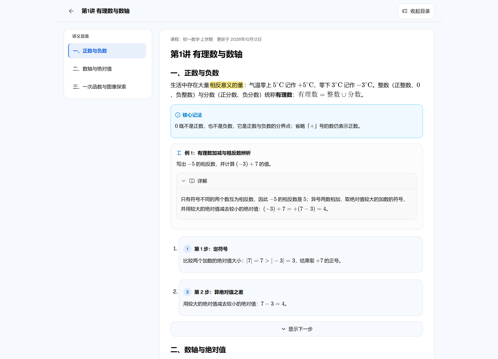
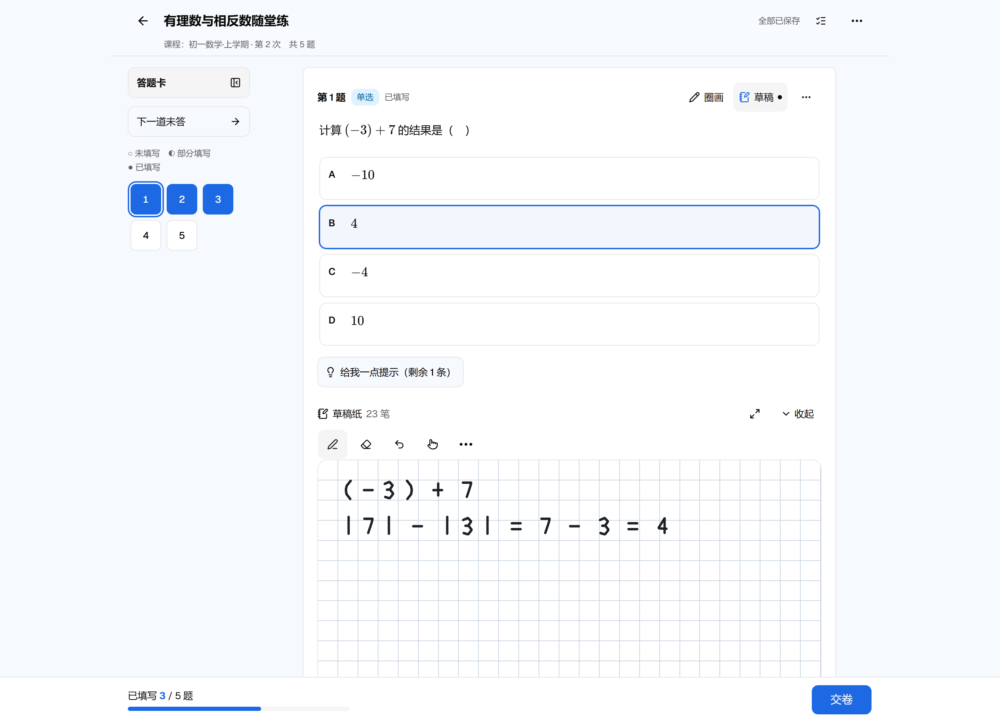
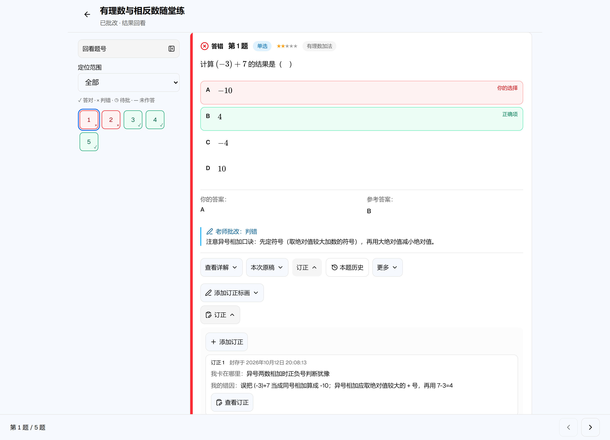
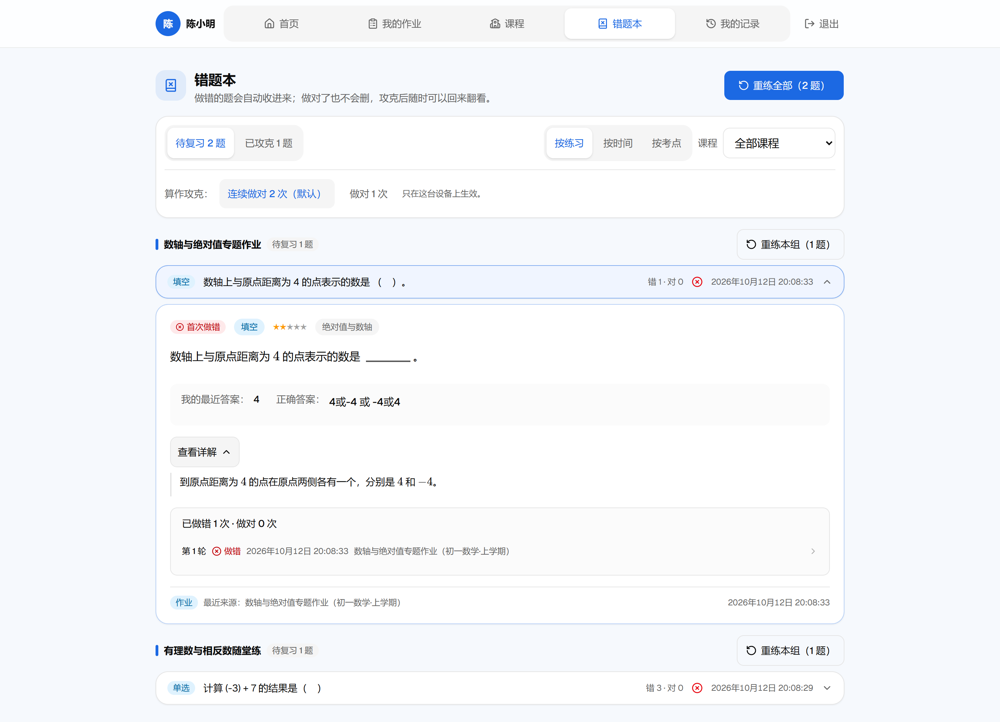
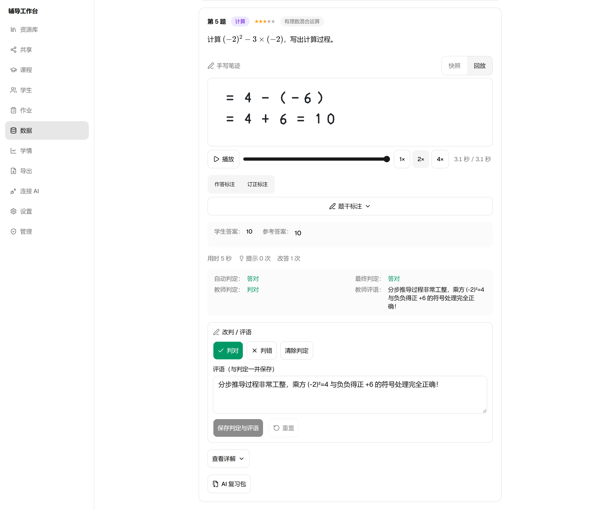
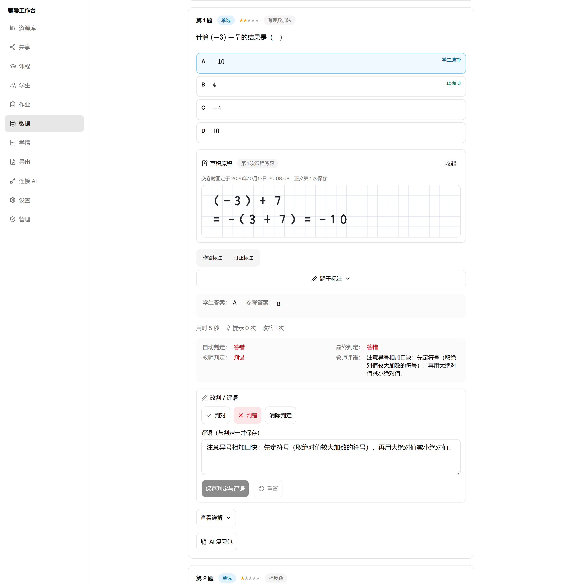
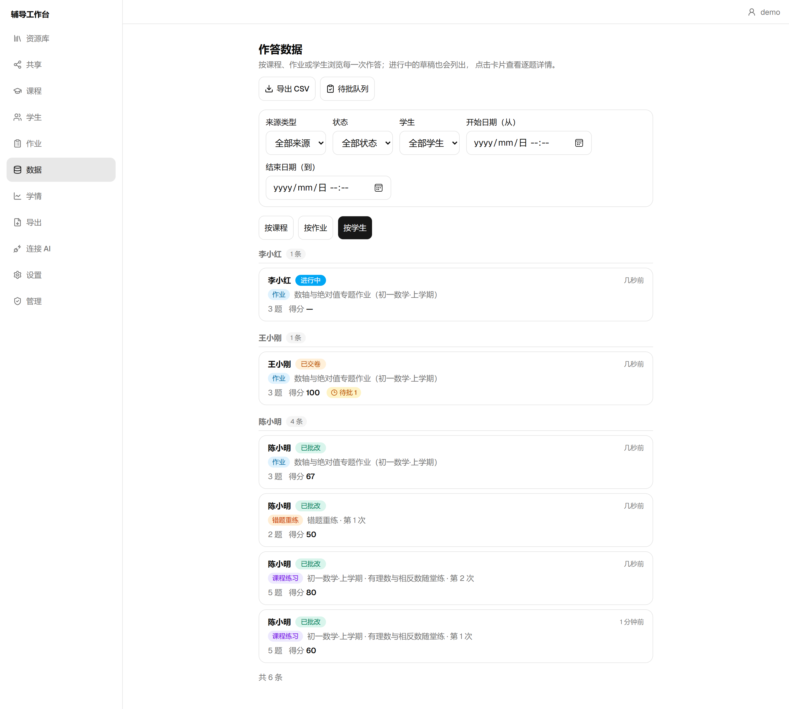
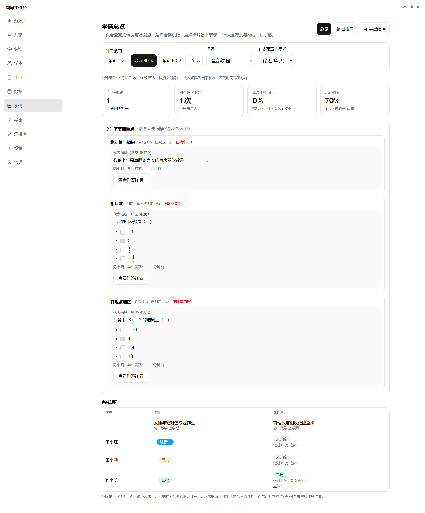

# simple-tutor-tool

[](https://github.com/LIziak112/simple-tutor-tool/actions/workflows/ci.yml)
[](LICENSE)

[English](README.en.md) · [简体中文](README.md)

A self-hosted, AI-native teaching and practice tool for online 1-on-1 tutors. It started as a fix for one tutor's daily headaches — lecture notes scattered across files, each student's progress living mostly in the tutor's head — and has been growing through real use ever since.

It tries to do one thing well, end to end: the tutor writes Markdown that follows a small spec (AI can help), imports it, and it becomes interactive lecture notes and exercises; students open a link and work through them — annotating question stems, working on scratchpads, and writing with Apple Pencil; the tutor then sees every student's answers, stroke-by-stroke handwriting replay, frozen scratchpad originals, corrections with reflections, and the learning analytics behind them; and the structured data plus handwriting evidence can be handed back to AI to review and prepare the next lesson.

**One process, data stays with you**: a single Node process serves the teacher app, the student app, and all the APIs; the data is one SQLite file plus a blobs directory inside a local `data/` folder (handwriting strokes, scratchpad originals, stem annotations, backups, and shared content all live in there) — nothing passes through any third-party platform, and backing up means copying the directory.

The core asset along this chain is a **data-structure contract shared across both ends** (the Zod schemas in [`packages/contract`](packages/contract)): upstream, MD that conforms to the contract is turned automatically into lecture notes and exercises; downstream, answer data and process evidence come out as structured JSON and standard images that AI can consume directly.

```
AI writes content (DSL-spec MD) ──→ import: auto-parse & render ──→ students answer (ink / scratchpad / annotate / correct)
         ▲                                                                                                │
         └──── AI diagnoses learning / per-question review / targeted practice ←── structured data & evidence ─┘
```

### What can you do with it?

- **For tutors**: leave scattered Word/PDF files and mental tracking behind. Author interactive lectures and question banks in Markdown (with AI assistance), assign homework or organize courses in one click; grade subjective questions quickly with keyboard shortcuts, replay student handwriting at multi-speed, and inspect frozen scratchpad originals and student reflections; spot what to teach next via the mastery matrix, weak-point rankings, and lecture reading maps.
- **For students**: nothing to install, no registration — open a personal link in an iPad or desktop browser and start. Read interactive lectures with typeset formulas and collapsible examples; circle key conditions on question stems, work on built-in scratchpads, or write full solutions with Apple Pencil; after submitting, file corrections with "where I got stuck / root cause" reflections, review the mistake notebook and per-question history notebook, and redo weak questions in one tap.
- **For AI collaboration**: no more copying and pasting questions and student answers into chat windows by hand. On the authoring side, [`dsl-kit/`](dsl-kit/) packs the DSL spec, prompt templates, and a zero-dependency offline linter; on the data side, export an "AI learning-data bundle (v1/v2)" or a single-question "AI review pack" with handwriting/correction images and anti-hallucination prompts, or connect Claude and other clients live via the built-in MCP server.

## Screenshots

| Interactive lecture (formulas / TOC / collapsible solution / step reveal) | Student answering & built-in grid scratchpad |
| --- | --- |
|  |  |

| Result review & sealed correction reflection | Student mistake notebook & multi-way redo |
| --- | --- |
|  |  |

| Teacher · multi-speed handwriting replay | Teacher · per-question grading & frozen scratchpad |
| --- | --- |
|  |  |

| Teacher · answer data (3-view grouping) | Teacher · analytics overview & next-lesson focus |
| --- | --- |
|  |  |

## Try it online

A live demo environment, seeded with sample data (it gets reset from time to time — please don't enter real student information):

- **Student side**: open the personal link and you're in — <http://47.116.99.166/s/L_N7GTSUpoWnxzR03laTsnzUP8lqpecS>; or sign in on the [student login page](http://47.116.99.166/s/login) with the name `测试` and password `12345678`.
- **Teacher side**: open the [teacher login page](http://47.116.99.166/t/login) and sign in with the login name `demo` and password `12345678`.

To see the whole chain, submit an exercise as the student, then open the "data" page as the teacher — per-question answers, the original handwriting images, and the learning analytics are all there.

## Supported modes

The tool supports several modes across content authoring, student practice, identity, and AI collaboration:

### 1. Content authoring modes (3 document `kind`s)

| Mode | Frontmatter | When to use & how it behaves |
| --- | --- | --- |
| **Lecture mode** | `kind: lecture` | Course lecture notes, split automatically at each `# 第 X 讲` heading; supports math formulas, collapsible worked examples (`:::example`), step-by-step reveals (`:::steps`), function plots (`::graph`), multi-column layouts, and inline highlights. |
| **Practice mode** | `kind: practice` | Question banks or worksheets, parsed automatically into structured items across **7 question types**: `judge` (true/false), `choice` (single choice), `multi` (multiple choice), `fill` (fill-in-the-blank), `solve` (calculation), `apply` (word problem), and `find-error` (spot the error — the last three are handwriting questions). |
| **Mixed mode** | `kind: mixed` | Lecture notes and companion exercises written in a single Markdown file; one import splits them into lecture sections and a linked practice unit automatically. |

### 2. Student learning & practice modes (3 attempt channels)

- **Homework assignment mode**: teachers assign one or more units to students, either as **"one assignment per unit"** (recommended — students complete and submit each independently) or **"merged into a single assignment"**; answer release supports **"immediately on submit"** or **"after due date"** (hiding correctness, reference answers, and worked solutions until the deadline).
- **Course self-practice mode**: students read visible lectures along the course outline and jump straight into companion practice units; reference answers and solutions are released on submit, with **unlimited retries** (each attempt starts fresh while preserving every historical attempt and snapshot).
- **Mistake redo mode**: the mistake notebook aggregates wrong answers across homework and course practice, with grouping by unit / time / knowledge point and course filtering; students can pick their mastery criterion (**strict: 2 consecutive correct answers** by default, or **lenient: 1 correct answer**) and launch a targeted redo set from the mistake notebook or the result page in one tap.

### 3. Identity & access modes

- **Dual student login modes**: supports both **personal link instant login** (ideal for iPad Safari "Add to Home Screen" full-screen PWA use) and **login name (defaults to student name) + password login**, each toggleable per student.
- **Multi-teacher isolation & sharing mode**: each teacher's library, courses, students, and assignments are strictly isolated; the first teacher is the admin (managing accounts and the self-registration switch), and teachers can publish units/lectures to the shared hub for peers to preview and import.
- **Same-browser dual-session mode**: teacher and student cookies are separated so a tutor can stay signed in as both teacher and test student in the same browser without logging each other out.

### 4. AI collaboration modes (3 ways in)

| Mode | Best for | How it works |
| --- | --- | --- |
| **Offline skill kit (`dsl-kit/`)** | Writing lectures, converting existing materials, and generating questions with local AI tools (Claude Code / Cursor / web LLMs) | Hand the [`dsl-kit/`](dsl-kit/) folder to your AI tool — it includes the DSL spec, complete samples, prompt templates, a material-organizing [`SKILL.md`](dsl-kit/SKILL.md), and a zero-dependency single-file linter `tutor-lint.mjs` (`node dsl-kit/tutor-lint.mjs <file>`) so AI can self-check to 0 errors offline. |
| **Bundle export (LearningPack v1/v2 & single-question review pack)** | Periodic learning reviews, per-question handwriting diagnosis, student self-review | A 5-step wizard exports a ZIP bundle with optional pseudonymization, staged **handwriting original / correction / stem-annotation images**, 5 built-in prompt templates, and honesty notes; single-question review packs or static composite PNGs can also be exported from any result page. |
| **Live MCP server (`/mcp`)** | Conversational workflows inside Claude Desktop or other MCP clients | Authenticate with a teacher API token at `/mcp` to give AI access to **14 built-in tools**: list students/courses/assignments, fetch v1/v2 learning packs and question stats, save diagnostic reports back to the app, inspect the DSL spec and capability manifest (`describe_capabilities`), and lint/import Markdown, images, or teaching-pack ZIPs. |

## Feature overview

### Content engine (Markdown in, interactive pages out)

- **Import and go**: drop in a lecture, practice, or mixed `.md` (along with any referenced local images) and it is typed, parsed, and structured in one step.
- **Interactive rendering & formulas**: Markdown, GFM tables, and math formulas (KaTeX, bundled locally — no CDN) are typeset automatically; worked examples stay collapsed until tapped, step-by-step derivations (`:::steps`) reveal progressively, and function plots (`::graph`) render dynamically.
- **Directive registry & capability manifest**: 17 directives are managed centrally — **published directives are append-only, so old content keeps working**; the host parses typed attributes via Zod, generates `capabilities.json` automatically, and lets teachers toggle auxiliary capabilities (step reveals, handwriting/scratchpad entry points) in Settings.
- **Teaching-pack round-trip & live editor**: frontmatter supports `teachingPack` capability declarations; the library can export a `.zip` teaching pack (Markdown + capability snapshot + local images) and re-import it losslessly; built-in CodeMirror 6 editor provides live lint diagnostics and versioned question edits (`version+1`).

### Student side (zero-friction reading, answering, and review loop)

- **Reading lectures**: typeset formulas, automatic table of contents (with active-section auto-centering as you scroll), collapsible worked examples, and links to companion exercises at the end of each lesson.
- **Answering across all question types**: true/false, single/multiple choice, fill-in-the-blank, and handwriting questions; optional MathLive virtual math keyboard; inline (Atrament) and full-screen (Excalidraw) handwriting; collapsible question-number card and on-demand step hints.
- **Built-in scratchpad & frozen originals**: non-handwriting questions include a **scratchpad** (blank/grid/lined paper, auto-expanding height, full-screen view with question stem and options reference, palm rejection / stylus-first mode, local IndexedDB persistence + server CAS sync); **submitting freezes an immutable original snapshot** that future redos never overwrite.
- **Fixed-base stem annotation**: students can circle and annotate directly on a fixed-width rasterized question stem (never drifts across screen rotations or zoom, seals on submit, and supports correction annotations on the result page).
- **Result review, corrections & per-question notebook**: a single-line action bar per question on the result page (worked solution, frozen original, correction, question history, more); students can start a correction from blank or **by copying their original scratchpad**, attach "where I got stuck / error cause" reflections, and seal it as a checkpoint; unsynced local drafts can be recovered as explicitly labeled **supplements**; the **per-question notebook** (`/s/notebook/:qid`) compares every round's original, corrections, supplements, and question version side by side.
- **Assignment list, My Records & mistake notebook**: the home page highlights the latest two pending assignments while the dedicated "My Assignments" page offers status, Beijing-date, and title filters with pagination; "My Records" indexes all historical attempts across homework, course self-practice, and mistake redos; the mistake notebook supports "To Review / Mastered" tabs, 3-way grouping, and one-tap redo.

### Teacher side (content assets, fast grading, and analytics)

- **Library & unified import wizard**: folder organization, lecture/unit/trash management; import single files, folders, or pasted text with dry-run action previews, cross-file conflict detection, and one-click "Copy errors for AI".
- **Courses, students & assignments**: course syllabus builder with section headers, visibility toggles, scheduled publishing, student-view preview, and member × unit progress matrix; 3-step homework assignment wizard.
- **Pending grading queue & stroke replay**: continuous grading queue (`/t/data/pending`) with keyboard shortcuts (`J/K` navigate, `1/2/0` mark right/wrong/clear, `U` undo); submission detail view supports **timestamped multi-speed handwriting replay (1×/2×/4× + scrubbing)**, scratchpad original / stem annotation / correction inspection, and inline re-marking with comments.
- **3-view learning analytics (ECharts)**:
  - **Overview**: pending count, redo stats, "Next Lesson Focus" weak knowledge points, and student × assignment/unit completion matrix.
  - **Student profile**: weekly accuracy trend, weak knowledge point bar chart, abnormal-time questions, **lecture reading map** (per-section dwell and idle time), and saved AI diagnostic reports.
  - **Question view**: per-question and per-knowledge-point accuracy, top wrong answers, and average/median time spent.
- **Export & backup/restore**: UTF-8 BOM CSV export (opens cleanly in Excel with handwriting image links); 5-step AI learning-pack wizard (v1/v2 with preview-time `asOf` snapshot pinning); one-click full ZIP backup and password-confirmed restore (with automatic pre-restore snapshot).

## How to use

### 1. Start the server (pick a run mode)

Requirements: Node.js ≥ 24, pnpm 12.6.0 (or just Docker for container deployment).

#### Option 1: Windows double-click scripts (easiest for local tutoring or demos)

Two batch scripts live in the repository root (run `pnpm install` once before your first launch):

- **Double-click `测试模式.cmd` (Dev / Demo mode)**: runs directly from source without a build step, serving the frontend at `http://localhost:5173` (students on the same Wi-Fi can open it on an iPad via your LAN IP) and the backend at `8787`, using the repo's `data/` directory; includes port-conflict detection and automatic cleanup on exit.
- **Double-click `启动服务.cmd` (Local production mode)**: checks/runs `pnpm build` and starts the single-process production server `node apps/server/dist/index.js` at `http://localhost:8787`.

#### Option 2: CLI development mode

```bash
pnpm install          # install dependencies
pnpm dev              # start server (8787) and web (Vite, default 5173, /api proxied; initializes DB on first launch)
pnpm seed:demo        # optional (run after the server has initialized the DB once): seeds demo data and prints the generated initial password for teacher `demo` (demo students use password `demo-pass-123`)
```

#### Option 3: Cloud server / production deployment (details in [docs/部署.md](docs/部署.md))

- **Docker Compose (recommended — Caddy reverse proxy & health checks included)**:
  ```bash
  git clone https://github.com/LIziak112/simple-tutor-tool.git && cd simple-tutor-tool
  mkdir -p data && sudo chown -R 1000:1000 data    # container runs as node user, uid 1000
  docker compose up -d --build                     # open http://localhost in a browser (public IP on a cloud server)
  ```
- **GHCR prebuilt image**:
  ```bash
  docker run -d -p 8787:8787 -v ./data:/app/data ghcr.io/liziak112/simple-tutor-tool
  ```
- **Bare-metal Node**: run `pnpm build` then `node apps/server/dist/index.js` under systemd.

Key environment variables:

| Variable | Default | Notes |
| --- | --- | --- |
| `PORT` | `8787` | Port the server listens on |
| `DATA_DIR` | `./data` | Data directory (`tutor.db`, `blobs/`, `shared/`, `backups/`, and `secret.key` all live here — back up this directory to back up everything) |
| `PUBLIC_URL` | `http://localhost:8787` | Public-facing URL; when `https://`, Secure cookies and the PWA service worker are enabled |

> Public deployment tip: turn off teacher self-registration in the admin panel (`/a`) and download periodic backups under "Settings → Backup & Restore".

### 2. Five steps for daily tutoring

1. **Initialize the teacher account**: the first visit opens the setup wizard (`/t/setup`) to create the admin teacher account. To explore with full analytics right away, run `pnpm seed:demo` after the server has initialized the database (sign in as `demo` with the random initial password printed in the terminal, or pass `--teacher <your-login-name>` to seed into an existing teacher domain), or import the sample files under `samples/v2/`.
2. **Author & import lectures/exercises**:
   - Give the [`dsl-kit/`](dsl-kit/) folder to your AI tool to convert existing notes or worksheets into valid `.md`, or copy the full prompt from "Import → AI Question Assistant".
   - Under "Library → Import", select `.md` files/folders or paste text; if any lint errors appear, click "Copy errors for AI", let the model fix them, and confirm the import.
3. **Build courses, add students & assign homework**:
   - Create a course under "Courses" and add lectures and practice units from your library;
   - Add students under "Students" and copy each student's **personal login link** (or password);
   - Use the "Assignments" wizard to assign units with a chosen grouping mode and due date.
4. **Students read, answer & file corrections**:
   - Students open their link on an iPad or computer to read lectures and complete homework or course practice;
   - While answering, they can annotate question stems, work on the scratchpad, or write full solutions by hand;
   - After submitting, they check worked solutions, file corrections with reflections on the result page, and redo weak questions from the mistake notebook until mastered.
5. **Grade, review analytics & prepare the next lesson with AI**:
   - Use keyboard shortcuts in "Data → Pending Queue" to grade fill-in and handwriting questions quickly, and replay strokes or inspect scratchpad originals and corrections in the detail view;
   - Check the mastery matrix, weak knowledge points, and lecture reading maps under "Analytics";
   - Export an AI learning-data bundle under "Export" (or connect an MCP client under "Connect AI") so AI can diagnose weak spots, review handwriting steps, and draft targeted follow-up exercises.

## Next steps & roadmap

With the core loop in place (content engine → all-type & handwriting/scratchpad/annotation answering → grading & correction loop → analytics & AI bundles/MCP → directive capabilities & teaching packs), upcoming iterations focus on:

1. **Integrated lesson mode (`kind: lesson`) with per-question instant feedback**
   - Designed for live "teach a concept, practice a question" sessions: questions stay inline inside the lecture flow, and students **submit one question at a time to unlock its result and worked solution on the spot** without waiting for a full-paper submission, while reusing frozen originals, corrections, the mistake notebook, and the teacher grading queue.
2. **Process-training gates & richer interactive components**
   - **Step gates & explorable lectures**: add optional gate conditions to `:::steps` (complete an inline blank or check before unlocking the next derivation step) and interactive parameter `sliders` to `::graph` so students can manipulate parameters and watch curves respond in real time.
   - **New display directives & interactive question types**: building on the 4-step directive pipeline (`registry → component → sample → gen:spec`), add tabs (`:::tabs`), audio/video (`::audio` / `::video`), timelines (`:::timeline`), and flashcards (`:::cards`), along with step-ordering (Parsons problems), drag-the-words, matching, categorization, and image hotspot questions.
3. **On-device iPad polish & advanced handwriting**
   - Complete full-scenario iPad + Apple Pencil calibration for long scratchpads, static composite image exports, and fixed-base stem annotations; evaluate multi-page focused writing and low-latency stroke prediction based on real tutoring feedback.
4. **Built-in BYO-Key AI assistant (optional extension)**
   - Complementing model-agnostic bundles and MCP, allow teachers to configure their own API key (OpenAI-compatible / Anthropic) in Settings for in-app streaming reports, one-click variant practice generation with automatic lint self-correction, and vision-model pre-grading suggestions for handwriting questions (always requiring teacher confirmation).
5. **Composable learning activities & smart daily review ("Today")**
   - Package structured teaching methods (such as step-by-step equation solving and error-cause attribution) into configurable, observable learning activities, and use accumulated evidence to drive a prioritized student "Today" review queue and teacher pre-class briefings.

## Tech stack

| Category | Choices |
| --- | --- |
| Language / contract | TypeScript (strict, no `any`) · Zod v4 (one schema shared by frontend and backend, plus JSON Schema and capability manifest exports for AI) |
| Frontend `apps/web` | React 19 · Vite · Tailwind CSS v4 · shadcn/ui (Radix) · TanStack Query · Zustand · React Router v7 · CodeMirror 6 · ECharts · KaTeX · function-plot · MathLive · Excalidraw + Atrament (handwriting & scratchpad engines) · html-to-image · vite-plugin-pwa |
| Backend `apps/server` | Node.js ≥ 24 · Hono (the frontend uses the `hc` RPC client for end-to-end types) · better-sqlite3 (WAL) · Drizzle ORM + drizzle-kit · pino · archiver · MCP SDK |
| Shared packages `packages/` | `contract` (Zod data contract & directive/capability registry, single source of truth) · `md-dsl` (unified/remark-based parser + linter + spec generator) · `grading` (pure-function grading & validator registry, server-side only) |
| Quality | Vitest (3800+ unit tests) · Playwright (90+ E2E tests, Chromium + WebKit iPad emulation) · Biome (lint + format) · GitHub Actions CI |
| Deployment | Docker multi-stage single container + Caddy reverse proxy (automatic HTTPS); or `node dist` + systemd / Windows one-click scripts |

## Architecture and repository layout

```
┌──────────────────── one Node process (apps/server) ────────────────────┐
│  static assets: apps/web build output (SPA + PWA + KaTeX fonts)        │
│  /api/teacher/* (teacher session)   /api/student/* (student session)   │
│  /mcp (teacher API token, 14 tools) /api/public/spec/* (spec/schema)   │
│  domain services: content & packs / attempts / notes & annotations /   │
│                   learning traces / analytics / export / MCP           │
│  data/tutor.db (SQLite WAL) · data/blobs/ (ink/notes/media) · backups/ │
└────────────────────────────────────────────────────────────────────────┘
    ▲ tutor (desktop / tablet)      ▲ students (iPad / phone / PC, PWA)      ▲ AI clients (MCP / dsl-kit)
```

Every contract lives in `packages/contract`; the frontend, backend, MCP, and export files all share the same schema.

```
simple-tutor-tool/
  apps/
    web/        # React frontend (student + teacher + admin, one SPA split by route)
    server/     # Hono backend (API + static assets + MCP + SQLite)
  packages/
    contract/   # Zod data contract & directive/capability registry (single source of truth)
    md-dsl/     # DSL parser + linter + spec generator + CLI (tutor-lint)
    grading/    # pure-function grading & validator registry (authoritative, server-side only)
  docs/         # architecture, deployment, DSL spec, feature lists, plans, progress
  dsl-kit/      # one-stop kit: DSL spec + samples + prompts + capabilities + skill + offline linter
  samples/      # sample MD documents (v2 set + lint counterexamples), also regression fixtures
  e2e/          # Playwright E2E test suite
  启动服务.cmd   # Windows one-click script for local production mode
  测试模式.cmd   # Windows one-click script for dev / demo mode
```

## Common commands

| Command | What it does |
| --- | --- |
| `pnpm dev` / `pnpm build` | Development (parallel) / full build |
| `pnpm test` / `pnpm e2e` | Unit tests (Vitest) / E2E (Playwright, Chromium + WebKit) |
| `pnpm lint` / `pnpm typecheck` / `pnpm format` | Biome check / type check / format |
| `pnpm db:generate` | Generate database migrations after changing the Drizzle schema (never hand-edit a live database) |
| `pnpm schema:export` | Export content and learning-pack contracts as JSON Schema (re-run and commit after changing contract) |
| `pnpm gen:spec` | Generate `docs/dsl/规范.md`, `提示词模板.md`, and `capabilities.json` from the directive registry, refresh JSON Schemas, sync the `dsl-kit/` distribution folder, and bundle its offline linter `tutor-lint.mjs` (must run after changing registry/lint/contract; CI verifies zero drift) |
| `pnpm tutor-lint <file or dir>` | Validate DSL documents; exits with code 1 on errors |
| `pnpm reparse [--dry-run]` | After a parser upgrade, re-extract structured fields from the source text stored in the database (question ids stay unchanged) |
| `pnpm seed:demo` | Seed demo data |

## Quality red lines

- **No answer leaks**: student-facing APIs never return the answer, worked solution, or hints of a question that hasn't been submitted; every new student-side endpoint must ship with a leak test (`assertNoLeak`).
- **Grading runs on the server only** (`packages/grading`); results coming from a client are never trusted.
- **Contract first**: data-structure changes start in `packages/contract`; the frontend and backend never each hand-write the same type.
- **DSL compatibility**: the historical samples in `samples/` are compatibility regression tests — after any change they must still parse and render identically.
- CI ([.github/workflows/ci.yml](.github/workflows/ci.yml)): lint / typecheck / unit tests / `gen:spec` drift check / build / E2E must all pass before merge.

## Documentation index

| Document | Contents |
| --- | --- |
| [docs/技术架构与实施方案.md](docs/技术架构与实施方案.md) | Architecture decisions and the implementation blueprint (the authoritative document) |
| [docs/部署.md](docs/部署.md) | Deployment, backup and restore, multi-teacher setup, FAQ |
| [docs/页面功能清单.md](docs/页面功能清单.md) | Page-by-page feature specifications and current status |
| [docs/题目草稿功能方案.md](docs/题目草稿功能方案.md) | Design spec for question scratchpads, frozen originals, corrections, stem annotations, and AI evidence bundles |
| [docs/组件渲染核心精进方案.md](docs/组件渲染核心精进方案.md) | Design spec for directive capabilities, validator registry, and teaching packs |
| [docs/项目最终愿景.md](docs/项目最终愿景.md) | Product positioning and vision |
| [docs/dsl/](docs/dsl/) | DSL spec, complete samples, capability manifest, and prompt templates for AI (generated by `pnpm gen:spec`, served at `/api/public/spec/*`) |
| [dsl-kit/](dsl-kit/) | One-stop kit for users' own AI tools: DSL spec + complete samples + prompt templates + capability manifest + material-organizing skill (SKILL.md) + single-file offline linter (tutor-lint.mjs) |
| [docs/进度表.md](docs/进度表.md) | Development task progress and acceptance records |
| [AGENTS.md](AGENTS.md) | Development working conventions (hard rules, equally binding on human and AI contributors) |

*Project docs are currently written in Chinese; an auto-translated read or a question in Discussions usually works fine.*

## License

[MIT](LICENSE) — use, modify, and deploy it freely. If it helps with your teaching, we'd love to hear about it: come back with an issue, or just tell us about your use case — that means more to us than a star.
