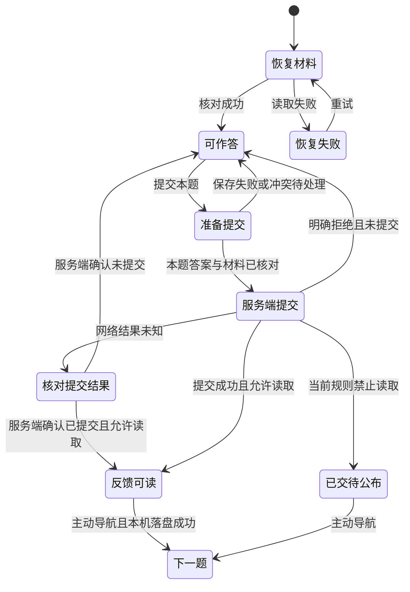

# 学生端做题方式与反馈节奏升级计划书

- 日期：2026-10-22。
- 状态：用户已授权实施；分批验收中（M0 设计确认与交互基线进行中，见 2026-10-22-student-practice-feedback-execution.md）。
- 范围：OwnClass 学生端课程练习、作业、错题重练，以及相关教师设置、DSL 推荐参数、结果回看与 AI 助教适配。
- 架构依据：`docs/技术架构与实施方案.md`、`AGENTS.md`、`docs/页面功能清单.md`、`docs/学生端AI伴学/需求规格.md`、`docs/学生端AI伴学/技术实施方案.md`。

## 1. 结论与产品目标

保留 `kind: practice` 和 `::::question` 内容结构，增加少量可选推荐参数，升级现有题卡、会话编排与服务端逐题提交能力。无需新增题型、独立背题卡片、判分引擎或前端技术栈。

学生独立选择两个维度：

| 维度 | 选项 | 产品含义 |
| --- | --- | --- |
| 做题方式 | 列表 / 单题专注 | 连续下滑，或一次聚焦一道完整题目 |
| 反馈节奏 | 每题提交后查看 / 交卷后统一查看 | 提交本题立即看本题解析，或保留整卷作答后回看的节奏 |

两者正交，四种组合都支持。单题专注不强制立即反馈，列表也可以逐题提交。教师限制优先于学生偏好；无教师限制的新练习，反馈节奏默认逐题即时反馈，布局默认列表，学生可改为单题专注。

核心闭环：**选择或填写 → 提交本题 → 原位呈现判定、答案与解析 → 主动进入下一题**。不自动跳过解析，不用固定等待、翻卡动画或反复确认拖慢高频操作。所谓“一秒一题”指简单题连续操作没有额外界面等待，不承诺任何网络条件下都一秒完成服务端判分。

重要边界：

- 单题专注中的长题可以滚动，不缩小字号或裁掉内容以塞进一屏。
- 当前可复用的全屏重点是手写纸面 `PaperPresentation`，它不等于所有题型的单题工作区；复用其同稿、收笔、焦点纪律，另建设完整题卡的呈现壳。
- 判分和答案释放必须经过服务端；普通取卷仍只下发公开题面。不能提前把答案下发再由 CSS 隐藏。
- 手写题、无标准答案题仍可能待批，“立即反馈”不等于“保证立即自动判对错”。已有参考答案、解析可在本题提交获准后显示，未配置时如实说明。
- 讲练页继续保持讲义与题卡原位混排及现有逐题语义，本次抽取共享能力，不将其强行改成普通练习分页。

## 2. 现状核对与复用基础

本轮核对的是仓库源码及文档，没有启动产品浏览器或进行手机、iPad 真机操作。用户提出的全屏控件体验问题作为设计输入，以下代码事实不等同于已经完成视觉验收。

| 已有实现 | 核对位置 | 可以复用 / 需要扩展 |
| --- | --- | --- |
| `practice` 解析为练习单元，题块结构稳定 | `dsl-kit/规范.md` 第一、二节；`packages/contract/src/content.ts` | 保留 kind、题目身份、题型、判分输入 |
| 通用课程、作业、错题会话 | `apps/web/src/features/attempt/AttemptSession.tsx` | 继续承载答案、材料恢复、交卷和来源导航，不复制第二套会话 |
| 统一公开题面与选择、判断、填空输入 | `features/attempt/QuestionSurface.tsx`、`FinalAnswerInput.tsx` | 共用交互控件，补齐只读、反馈与单题密度；填空继续题干内作答 |
| 正式手写同稿全屏 | `features/ink/PaperPresentation.tsx`、`features/attempt/HandwrittenControls.tsx` | 保持宿主、引擎、doc、撤销历史；处理单题工作区与纸面全屏的层级 |
| 逐题提交、锁定、最后一题自动收尾 | `apps/server/src/services/attempt-service.ts` 的 `submitLessonQuestion` | 目前显式限定 lesson，需抽取通用领域能力和权限裁决 |
| 讲练题级结果与前端提交编排 | `features/lesson/use-lesson-attempt.ts`、`LessonQuestionCard.tsx` | 复用逐题材料准备、返回结果覆盖和错误收敛，保留 lesson 适配器 |
| 逐题答案版本协议 | `use-attempt-answers.ts`、`draft-store.ts`、`attempt.ts` | 沿用 baseRevision / mutationId，增加本题提交对已保存答案版本的确认 |
| 作业公布策略 | `assignment.ts`、`assignment-service.ts`、`attempt-service.ts` | 现有 `on_submit` 是整卷交卷后公布；`after_due` 是截止后公布，不能静默改义 |
| 待批共享谓词 | `services/pending-mark.ts` | 已允许 draft 卷中 submittedAt 非空的行进入待批；检查全部消费方不再限定 lesson |
| AI 展示偏好与唯一阅读工作区 | `student-ai-display.ts`、`AiCompanionDock.tsx`、`AiReadingWorkspace.tsx` | 保留题下、侧边、弹窗三偏好及空间不足时的回退规则 |
| AI 完成态 | `services/ai-companion/teaching-policy-service.ts` 的 `phaseOfRows` | 当前普通来源看整卷状态；新增逐题模式后要识别已提交的本题 |
| 阅读位置、切题、材料落盘 | `use-reading-position.ts`、`AttemptEditorContext.tsx`、`attempt-material-recovery.ts` | 扩展为列表与单题共用的定位和安全切换 |

规模判断：布局是中等前端任务；逐题反馈是中等规模的领域扩展，横跨接口、安全、证据、批改和 AI。难点不在 Markdown 语法，而在状态与权限一致性。

## 3. 竞品调研：证据、可迁移体验与边界

### 3.1 调研方法

调研日期为 2026-10-22，使用开发者在 App Store 的产品说明、腾讯官方产品文档和接口文档。未登录竞品付费账号、未实际操作小程序，也未测量其交互延迟。官方没有披露的默认开关、快捷键、自动跳题时序、iPad 分屏细节和内部技术架构，统一列为未知，不写成竞品事实。

“腾讯系”区分自营产品和运行在微信上的第三方产品。本次采用腾讯问卷、腾讯乐享作自营样本，不将腾讯云社区里的第三方源码或微信小程序自动认定为腾讯产品。

### 3.2 样本对照

| 样本 | 官方可核实的功能 | 对本项目的启发（设计推导） | 不迁移的部分 / 证据限制 |
| --- | --- | --- | --- |
| 粉笔 | iPhone、iPad 支持；考点专项练习、详细解析、练习记录与评估报告、个性出题 | 以“题目 → 反馈 → 薄弱点复习”组织闭环；解析与下一题入口都应容易到达 | 不引入商业课程、预测分与大题库推荐；官方说明不足以证明当前每题提交按钮位置或平板双栏交互。来源：[粉笔官方应用页](https://apps.apple.com/cn/app/%E7%B2%89%E7%AC%94-%E5%A4%A7%E5%AD%A6%E7%94%9F%E5%8F%8A%E5%9C%A8%E8%81%8C%E8%80%83%E7%BC%96%E8%80%83%E8%AF%81%E7%A5%9E%E5%99%A8/id584660358) |
| 华图在线 | iPhone、iPad 支持；做题/背题切换、错题重练、随堂练习、AI 批改；版本说明包含草稿笔与橡皮粗细调整 | 学习节奏应可选择，原稿和解析应就近访问；同一题库可以支持不同练习方式 | 只借鉴低摩擦检验节奏，不做直接看答案的背题卡片；草稿工具不能替代本项目的证据封存。来源：[华图官方应用页](https://apps.apple.com/cn/app/%E5%8D%8E%E5%9B%BE%E5%9C%A8%E7%BA%BF-%E5%85%AC%E5%8A%A1%E5%91%98%E4%BA%8B%E4%B8%9A%E5%8D%95%E4%BD%8D%E8%80%83%E8%AF%95%E5%A4%87%E8%80%83%E5%AE%9D%E5%85%B8/id940376535) |
| 驾考宝典 | 官方标注专为 iPad 设计；理论题库、仿真模拟考试、考点视频解析 | 将练习与考核分开，保留稳定进度与清楚的题级反馈；短题高频流程应避免多余弹窗 | 不迁移驾考题型假设、商业会员和排行榜；不根据应用评论推断所有用户的实际交互。来源：[驾考宝典官方应用页](https://apps.apple.com/cn/app/%E9%A9%BE%E8%80%83%E5%AE%9D%E5%85%B8-2026%E9%A9%BE%E6%A0%A1%E5%AD%A6%E8%BD%A6%E8%80%83%E9%A9%BE%E7%85%A7%E7%A7%91%E7%9B%AE%E4%B8%80%E7%A7%91%E7%9B%AE%E5%9B%9B%E7%90%86%E8%AE%BA%E5%9F%B9%E8%AE%AD%E9%A2%98%E5%BA%93%E8%BD%AF%E4%BB%B6/id491024740) |
| 腾讯问卷 | 多考试题型、自动阅卷与人工评分、时长及截止控制；电脑/手机分别试答，可完整验证输入、分页及提交流程 | 教师发布规则是约束，学生展示偏好不能放宽；验收要在实际题型与两端流程中完成 | 它是测评工具，官方资料未证明其具备本需求的逐题即时反馈；不能宣称其“小程序一秒一题”。来源：[考试](https://cloud.tencent.com/document/product/1304/133261)、[预览试答](https://cloud.tencent.com/document/product/1304/135478) |
| 腾讯乐享 | 官方考试接口区分考试、试卷、题库、题目及成员成绩，包含完成后与结束后的查看权限参数 | 内容、一次作答、反馈权限分层；不能把“题库有答案”视为“学生现在能读取答案” | 这是管理与集成接口证据，不是学生 UI 实测，也不能推导对方的防泄露实现。来源：[腾讯乐享考试接口](https://lexiangla.com/wiki/service/11015.html) |

### 3.3 手机与 iPad 的迁移结论

以下是面向 OwnClass 的交互方案，不是对竞品未经验证的截图复述。

1. 手机采用一个主阅读流、固定且可到达的主操作、就近解析；减少来回滚到页面底部的距离。
2. iPad 根据工作区真实可用宽度安排题目、纸面与 AI；不因设备名叫 iPad 就强制多栏。
3. 题目导航、当前题号、已提交进度持续可达；“未答”“已填未交”“已提交”“待批”分开表达。
4. 选中、提交、下一题三个动作语义分开，避免为快而牺牲多选、填空、长题阅读的可靠性。
5. 本项目特有的手写证据、跨设备冲突与受控 AI 出口决定了不能照搬纯客观题 App 的客户端即时判分或离线答案预载。

开发前的原型验收须用手机和 iPad 各跑一次本项目的四种模式组合。竞品进一步真机体验可补充细节，但不作为架构决定的阻塞前提，也不以未证实的竞品行为作为验收标准。

## 4. 功能范围与优先级

| 优先级 | 交付范围 |
| --- | --- |
| P0：完整发布必需 | 四种模式组合；教师约束；学生偏好与来源恢复；七种题型；逐题判分/反馈/锁定；单题专注；题目导航和快捷键；弱网、冲突和提交重试；手写及标画保护；AI 三布局；结果、批改和统计；历史兼容及防泄露 |
| P1：发布前体验打磨 | 长解析定位、细化空态、低性能设备与连续提交性能调优、题下和侧栏宽度微调、使用帮助与截图文档 |
| 明确不在范围 | 独立背题卡片、认识/不认识自评、间隔重复算法、刷题排行榜、选项点击即自动提交、自动跳过解析、新题型、新 AI 教学模式、新手写引擎、题库随机重排 |

P0 不能只交付布局而把逐题反馈、AI 或安全收尾作为不确定的后续工作。允许分批开发，但完整发布需要各批次共同验收。

## 5. 教师约束、学生选择与兼容规则

### 5.1 三种用户可理解的教师规则

教师界面统一显示：

- **由学生选择**：学生可选择每题提交后查看，或交卷后统一查看。
- **交卷后公布**：学生可以选布局，反馈节奏固定整卷。
- **截止后公布**：沿用现有截止时间校验与待公布界面，反馈节奏固定整卷。

不存在现成“教室”实体时，不为本功能新建一套教室模型。默认规则进入现有教师设置“教学”分类，作业进入现有布置/编辑入口。课程自由练习使用教师默认规则，作业使用其明确规则，错题重练使用所属教师默认规则；当前范围不新增课程级、学生级反馈覆盖，以免复制 AI 的多层策略系统。

“截止后公布”仍要求 dueAt；即使截止已过，未提交题也不能直接获取解析，仍按该卷整卷提交口径处理。

### 5.2 最小兼容表示：保留 answerRelease，增加粒度授权

建议保留 `answerRelease: on_submit | after_due` 的契约和值，新添 `allowPerQuestionFeedback: boolean`。不扩充既有枚举、不把历史 `on_submit` 自动解释成学生任选。

| 教师 UI | answerRelease | allowPerQuestionFeedback | 生效模式 |
| --- | --- | --- | --- |
| 由学生选择 | on_submit | true | 学生选 per_question 或 after_attempt |
| 交卷后公布 | on_submit | false | after_attempt |
| 截止后公布 | after_due | false | after_attempt，结果仍等截止 |

这两个字段分别表达既有整卷公布时点与新增题级授权，由同一个服务端 resolver 裁决，UI 不提供可能冲突的两组开关。`after_due + true` 在新写入入口拒绝；读到异常历史组合时按禁止逐题反馈处理。

保存教师选择时两字段同事务更新。旧客户端只提交旧 `answerRelease` 的作业创建/修改请求，统一解释为对应的旧限制规则并写 `allowPerQuestionFeedback=false`，不能保留一个隐藏的 true 来意外放宽新规则。旧客户端不修改公布字段时，不改现有授权。

新增教师默认配置建议为 `practiceFeedbackPolicy: student_choice | after_attempt`，保存到教师域的独立可选配置列，不混入只有 steps/ink 的辅助能力开关。新版本对尚未配置的自由练习默认 student_choice；教师设置页明确展示有效默认值。

### 5.3 默认与历史迁移

| 场景 | 升级后默认 |
| --- | --- |
| 历史已完成卷 | 原结果和公布规则不变，不重判、不重建、不回填伪造题级提交时间 |
| 历史进行中普通卷 | 保持 after_attempt，可切布局；本期不将旧协议作答升级为逐题协议，继续原卷或显式重新开始 |
| 历史作业 | 新字段回填 false，原 on_submit / after_due 不变；教师可显式改为由学生选择 |
| 新版教师 UI 新建作业 | 默认由学生选择，明确传 true；教师可切换两种限制 |
| 旧 API/MCP 调用方创建作业，未传新字段 | 按旧逻辑 false，避免第三方调用无意放宽；更新契约和提示文档后才显式开启 |
| 新版课程自由练习 / 错题重练 | 教师未限制时默认 per_question，学生可选择 after_attempt |
| 既有 lesson | 仍是原位题级提交与当题释放，不应用普通作业限制，也不改变讲练内容投影 |

旧文档无需修改。新产品默认只影响新协议建卷，不改历史卷。旧客户端对新逐题卷的写请求因缺少工作流版本被服务端拒绝并提示刷新，不能退回整卷无版本写入。

### 5.4 学生偏好、文档建议与最终模式

推荐顺序：

1. 续作先采用服务端该 attempt 已确定的反馈节奏。
2. 新建卷读取学生本次明确选择；否则读取本设备保存的学习偏好。
3. 没有学生偏好时读取文档推荐；仍未指定时列表 + 逐题反馈。
4. 服务端应用教师限制，得出实际反馈节奏及原因；客户端只按裁决展示。

布局不是权限，可随时切换；反馈节奏建卷时存到 attempt，在首次题级/整卷提交前可明确更改，需服务端 CAS。首次提交后固定到本卷结束，避免既看答案又撤回成“从未看过答案”的整卷考核。改变个人默认偏好只影响后续新卷。

教师在进行中收紧规则时，立即停止后续不允许的普通反馈读取及逐题提交，已提交行与成绩保留；页面显示规则变更，提供“继续完成剩余题目并交卷”。已下发内容无法撤回，不宣称已看答案重新保密。收紧后的已提交题在重取时按当前 gate 返回受限状态。

教师放宽规则不自动改变当前卷的学生节奏。新协议卷若尚无提交，可重新选择；已提交后保持该卷选择。实际已释放内容与已提交事实不回滚。

## 6. 参数、契约、存储与 DSL 设计

### 6.1 共享契约建议

以下是设计草案，正式实现先在 `packages/contract` 定义 Zod schema，再从 schema 推导类型，禁止前后端各自抄写。

```ts
const practiceLayoutSchema = z.enum(["list", "single"]);
const practiceFeedbackModeSchema = z.enum(["per_question", "after_attempt"]);

// 本设备偏好只包含版本、枚举和是否启用快捷键。
const studentPracticePreferenceSchema = z.object({
  version: z.literal(1),
  layout: practiceLayoutSchema,
  feedback: practiceFeedbackModeSchema,
  keyboardShortcuts: z.boolean(),
});
```

新增服务器返回的 `practiceWorkflow`，至少包含：

| 字段 | 用途 |
| --- | --- |
| version | 协议版本，旧响应缺失则按整卷旧协议处理，不能默认授权 |
| feedbackMode | 本卷确定的学生反馈节奏 |
| revision | 模式修改及提交时 CAS，避免另一设备同时改节奏 |
| canChangeFeedback | 当前能否更改本卷节奏 |
| allowedFeedbackModes | 当前教师规则允许的集合，必须包含可行选项 |
| canSubmitQuestion | 当前是否允许继续逐题提交；规则收紧时可为 false，但不改写本卷已选择的 feedbackMode |
| restrictionReason | teacher_after_attempt / teacher_after_due / legacy_attempt 等，不含任何题目秘密 |
| releaseAt | 可公开的截止时间，可空，不复制答案 |

题级进度另建白名单契约：questionId、submittedAt、当前是否允许读取反馈。不得在纯状态字段夹带 autoCorrect、得分或暗示答案的摘要。

普通 `AttemptDraftData` 保持公开题面和本人 drafts；新增可选工作流及题级状态，不把已提交题的标准答案混入 `units.questions`。题级反馈通过专用读端点读取；刷新当前题、回看已提交题、提交回执三者共用同一个授权投影。

### 6.2 数据库改动

| 位置 | 新增内容 | 迁移原则 |
| --- | --- | --- |
| teachers | 可选 practiceFeedbackPolicy 配置 | 未设置时仅对新普通自由练习采用 student_choice；不改历史 attempt |
| assignments | allowPerQuestionFeedback | false 兼容默认；与 answerRelease 组合验证 |
| attempts | practiceWorkflowVersion、feedbackMode、workflowRevision | 旧行按旧协议 after_attempt；新普通卷显式写版本与模式；lesson 保持其适配路径 |
| responses | 单题提交 mutationId 与请求摘要（用于可靠重试） | submittedAt、finalCorrect、快照、答案 revision 继续复用，不建第二套 response |
| units | 可选 practiceDefaultsJson | 只保存导入的展示/反馈推荐，不能成为权限配置 |

若实现核对发现已有字段或幂等设施能够完整表达上述含义，优先复用。迁移统一由 drizzle-kit 生成并验证，不手改线上库。更新备份导出/恢复的字段检查与旧备份缺省路径，新字段不能在恢复后丢失或意外放宽权限。

### 6.3 DSL：可选推荐，不新建 kind

建议语法：

```yaml
---
kind: practice
unit: 有理数基础练习
practice:
  layout: single
  feedback: per_question
---

::::question{#rational-01 type=choice}
$1 + (-1)$ 的结果是？

- [ ] $1$
- [x] $0$
- [ ] $-1$

:::solution
互为相反数的两个数相加得 $0$。
:::
::::
```

上例题块使用已有语法；`practice` 推荐参数尚未实现，不能将整份示例视为当前版本已支持的功能。实施后将该示例加入解析、导入、导出和渲染回归。

`practice` 命名空间仅表达新建卷的推荐值，学生明确选择优先，教师限制最终裁决。文档作者不能通过 `feedback: per_question` 越过作业截止或教师要求。无该字段时按产品默认解析推荐；解析结果保留“未声明”，不提前注入默认值覆盖学生偏好。各新增字段可选，缺省由唯一 resolver 处理。

适用 `practice` 和 `mixed` 的练习单元；`lecture` / `lesson` 声明时给“不适用”warning，不改变讲练的原位教学语义。共享与重导时保留字段；没有推荐字段的重导清除旧推荐。多单元作业推荐不一致时不自动拼出多个反馈节奏：只采纳一致的推荐，冲突回到学生偏好/产品缺省，并在开始页允许选择。

改动链：契约 → frontmatter 解析 → Unit 结构 → 导入保存/预览 → 教师 Markdown/教学包导出 → 新建卷读取 → DSL 文案与样例 → `pnpm gen:spec`。`dsl-kit/规范.md` 是生成文件，不直接手改；此扩展不新增指令，无需假造注册表指令。所有现存 samples 继续解析、渲染一致。

## 7. 学生入口、布局与视觉规范

### 7.1 入口及设置

- 学生设置“学习偏好”新增“做题方式”配置行：默认布局、默认反馈节奏、键盘快捷键。选择暂存，保存后才影响默认偏好，沿用账号与部署隔离。
- 课程练习、错题重练和作业开始区显示一行摘要：“列表 · 每题提交后查看”，可展开修改；不为每次进入增加必经设置弹窗。
- 续作直接恢复本卷；限制场景显示“老师要求交卷后公布”或“老师要求截止后公布”，原因紧邻被限制选项。
- 作答页通过“更多 → 做题方式”切换列表/单题；移动端顶栏仍只保留返回、单元名与更多，题号与进度放在工作区内的紧凑行，不塞满顶栏。
- 默认偏好 localStorage 仅存枚举、版本及快捷键开关，按部署来源、student 角色、账号隔离。存储失败保留本次选择并提示未保存默认，不阻断答题。答案、AI 正文、材料和凭据不新增持久化副本。
- 快捷键默认启用，但只在显式工作区焦点域生效；学生可关闭。登录、退出和换账号时同步绑定/重置偏好及查询，沿用现有角色缓存清理，不删除未同步本机稿。

### 7.2 单题专注结构

```text
返回                 单元名称                 更多
第 8 / 20 题 · 已提交 7 题                  题目导航
─────────────────────────────────────────────
题型、难度、考点                  圈画 / 草稿 / …
题干（长题允许滚动）
选项或题干内填空 / 正式手写与最终答案

本题结果、答案、解析（仅获得授权后出现）
AI 助教（按学生偏好题下 / 侧边 / 弹窗）
─────────────────────────────────────────────
上一题              提交本题 → 查看反馈 → 下一题
```

主按钮不是同时出现三个动作：按当前状态依次显示“提交本题”“正在提交…”“下一题”；交卷后反馈模式则显示“下一题”，最后通过明确“交卷”入口结束。提交本题不能兼作进入下一题，必须先让当前题结果可见。

单题专注是页面内布局，覆盖所有七种题型，不依赖浏览器 Fullscreen API；PWA 与普通浏览器都可用。已有纸面“全屏作答”继续用于大面积书写，与页面“单题专注”用不同名称。页面专注中再开纸面全屏时，退出纸面回当前题；不叠加两套工作区页脚或两个模态焦点锁。

### 7.3 列表模式

所有题卡外框跟随同一内容列宽度。列表逐题反馈时，每题底部提供本题提交区和结果区；全局底栏显示已提交进度及交卷入口。列表整卷反馈维持熟悉的连续作答。

点击“下一题”或快捷键时使用题目顺序定位下一题顶部，避让实际顶栏；正常手动滚动不被抢回。列表中可同时保留多题已经展开的解析，但 AI 活动正文与输入仍只有一份。

### 7.4 响应式与视觉起始规格

| 项目 | 设计基线与约束 |
| --- | --- |
| 题卡外框 | 沿用学生端 token 和既有 8px 圆角；不因题型、纸面、AI 开合另设外框 max-width |
| 阅读字号 | 题干与解析起点 16px、行高约 1.75；iPad 可随既有排版适当增大，不强迫缩小 |
| 选项 | 整行可点击，最小 48px 高，长文本/公式自然换行；选中带形状/文字，不只变颜色 |
| 操作区 | 触控目标至少 44×44px，主动作优先；更多项承接低频工具 |
| 手机 | 以 320、390、430 CSS px 检查；单阅读流，解析和 AI 不挤成窄双栏 |
| iPad | 检查 768/820 竖屏、1024/1180 横屏及实际分屏宽度；由容器尺寸决定纸面和 AI 的排布 |
| AI 侧边 | 沿用当前 compare 可用宽度判定（当前常量 1060px）；只在实测足够时使用，不另建一组设备断点 |
| 空间分配 | 不同时强塞导航列、题目列、草稿列和 AI 列；优先收导航，纸面改上下；AI 不足时按既有偏好回退弹窗 |
| 页面高度 | 使用动态视口与现有 visualViewport 观测；安全区留白；不禁止页面缩放 |
| 动效 | 高频切题无滑动/翻面强制动画；状态变化可用短颜色过渡，尊重 reduced-motion |

已有标画底图的题面必须遵守保存时的逻辑尺寸，整体缩放，不能把笔迹叠到重新换行的题干。新旧布局不兼容时保持原生题干内作答且明确处理旧标画，不自动覆写或擅自维护重置。AI 阅读宽度仅控制 AI 阅读列，不改变题卡外框。

## 8. 题型交互与快速反馈

| 题型 | 作答态 | 提交后的反馈态 |
| --- | --- | --- |
| 判断 | 两个大触控选项，原生 radio，键盘可操作 | “你的答案 / 参考答案”明确区分，图标与文字表达判定 |
| 单选 | 整行选项命中、公式和图片不截断；点击只选中 | 保持题面和选项位置，标明本人的选择和正确项，不把颜色作为唯一线索 |
| 多选 | 原生 checkbox，允许取消；明确“多选题” | 显示实际选择与参考集合，沿用现有判分，不新增局部得分规则 |
| 填空 | 继续题干内输入，空位有“第 n 空”可访问名称；Tab 逐空，软键盘下一项 | 保留本人各空答案，答案对照在题面之后；不得用第二套独立输入替代原题空位 |
| solve / apply / find-error | 复用正式手写、草稿、标画及最终答案输入；普通/数学键盘继续复用 | 自动可判时给判定，否则“已提交，待老师批改”；已有原稿只读，本题后续修改走订正 |

七种题型共用题卡生命周期。不能为单题专注手写一套题干、选择框、填空模型，也不能把富文本渲染成图片作为全部作答控件。

反馈区域按以下顺序组织：

1. 简短结论：“回答正确”“回答有误”或“已提交，待老师批改”。
2. 本人答案与参考答案；无标准答案明确说明，不制造空白卡片。
3. 本题详解默认展开，保留原题上下文；超长解析自然滚动，不要求先点“查看详解”。
4. AI 求助入口及已有回复，按既有偏好呈现，不替代老师解析，也不自动发起请求。
5. 下一题按钮持续可达，回看当前题不会覆盖答案或重记一次提交。

正常有答案提交不弹确认；无作答时主按钮禁用并提供次级“不会，提交并看解析”明确动作，按现有未作答判分处理。该动作不是“跳过”；“先跳过”只切题、保留未提交状态。缺稿、保存失败或冲突继续采用已有明确确认/阻断流程，不能因追求快省略。

最后一题提交：事务自动完成整卷，但当前界面仍停留本题反馈，不立即跳到整卷结果覆盖刚显示的解析；主动作改为“查看本次结果”。若前面仍有跳过题，显示“继续未提交题目”。

## 9. 状态机、导航与快捷键

### 9.1 状态不能混用

持久业务状态：未提交 / 已提交，attempt 仍用 draft / submitted / graded。UI 过程状态：恢复中、编辑中、准备提交、提交中、结果可读、已提交但当前待公布、保存失败、冲突、权限失效。禁止用“输入框有值”表示“已完成”。



题目导航区用文字/图标区分未答、已填未交、已提交、待批；统一公布模式不显示未授权的红绿对错，也不通过进度统计泄露正确率。

### 9.2 键盘方案

| 键位 | 条件与动作 |
| --- | --- |
| Enter | 非文本编辑区、工作区有焦点时，执行当前主动作：未提交则提交，反馈态则下一题；radio/checkbox 焦点也支持，按钮/链接保留自己的 Enter 动作 |
| ← / → | 仅工作区容器本身有焦点、未打开模态时，上一题/下一题；原生选项、可横向滚动公式及输入控件中的方向键保持自身语义；不注册浏览器历史用的 Alt+方向键 |
| 1…9 | 专注模式、非文本编辑区且学生已启用快捷键时，选择/切换当前题可见选项；超出范围不处理 |
| Tab / Shift+Tab | 原生焦点顺序，填空逐空，radio/checkbox 保留平台键盘语义 |
| Esc | 先关闭最上层菜单/AI 弹窗/纸面全屏，返回真实入口；普通页面专注不通过全局 Esc 退出作答 |

保护规则：

- 文本、数值等可编辑 input，以及 textarea、contenteditable、MathLive、AI 输入和其 shadow DOM 不捕获题目快捷键；radio/checkbox 不是文本编辑区。检查 composedPath，而非只检查 event.target。
- 输入法合成态、defaultPrevented、event.repeat、按键长按、指针书写中、提交中、恢复中、冲突中均不推进。
- 一次按下只执行一个状态动作；提交成功后必须收到新的 keydown 才能下一题。不得让同一事件在状态更新后再次进入下一题，更不得把回车连按带到下一题自动空交。
- 原生选项的 Space/方向键保持选择语义，按钮和链接的 Enter 只执行自身动作，不再冒泡执行一次主动作；单字母/数字快捷键可关闭，默认仅在明确工作区焦点域生效。
- 快捷键帮助写在“更多 → 快捷键”，主按钮可显示简短提示；手机不展示无效键帽。

导航失败保留当前题、原稿和 AI 草稿，提示“本机稿未保存，仍停留本题”，提供重试，不清空后跳页。新题导航后焦点到题号/题干容器，不默认弹出软键盘；明确“下一空”才移动输入焦点。

## 10. 服务端提交、读取与安全设计

### 10.1 单一裁决与端点

从 `submitLessonQuestion` 抽取 `submitAttemptQuestion` 领域服务，lesson 保留兼容导出/适配器。是否允许逐题提交由工作流与教师规则裁决，不能删掉 sourceType 检查后直接放行所有卷。

| 入口 | 计划行为 |
| --- | --- |
| 现有新建/重开接口 | 新增可选 feedbackMode 与 workflowVersion；新协议客户端显式传入，服务端校验教师约束；省略按旧协议 |
| GET /api/student/attempts/:id | 新增可选工作流、题级提交状态；题面仍用公开投影，不附整卷答案 |
| PATCH /api/student/attempts/:id/workflow（新增） | 首次提交前更改反馈节奏，携带 workflowRevision；不更改题目快照与稿件 |
| POST /api/student/attempts/:id/questions/:questionId/submit（扩展现有） | 支持有授权的新普通逐题卷；保留 lesson 旧协议行为；只返回本题安全反馈、进度及最新 attempt 摘要 |
| GET /api/student/attempts/:id/questions/:questionId/feedback（新增） | 已提交且满足本卷反馈节奏与当前教师 gate 才给答案解析；未授权返回不含结果秘密的待公布状态 |
| 现有整卷 submit | 对已提交行不重判、不覆盖材料；只判剩余行；剩余空题先用现有确认流程说明 |

新增/扩展接口均加泄露测试。提交回执不依赖再次拉全卷或拉全结果才显示解析。反馈 GET 支持浏览器刷新和未知提交结果收敛，仍执行归属、作废、课程失权和当前教师策略检查。

提交与反馈响应使用 `Cache-Control: private, no-store`，不落入 PWA 公共资源缓存或新增浏览器持久化仓。客户端内存查询按学生身份、attempt、question 分键；退出、换号、失权时沿用现有角色缓存清理。教师收紧“立即生效”指服务端每个后续读写立即按新规则裁决，不声称能撤回已看内容。页面重获焦点/联网时刷新工作流；收到策略变更或待公布响应后清除本卷内存中不再允许呈现的普通反馈，保留本人的原稿和答案。

### 10.2 本题提交的必要顺序

1. 前端冻结本次操作目标 `(账号会话, attemptId, questionId, questionRevisionId)`，立即关闭重复提交入口。
2. 收笔并等待该题的本机标画、草稿、正式手写落盘；答案结束该题防抖及在途请求，取得服务端确认的答案 revision。
3. 只追平本题需封存的上传与证据，沿用 prepareSubmitEvidence 的 frozen / none / missing 语义；本机正文读取/保存失败必须阻断，不能伪装成 missing 放行。
4. 请求携带 workflowVersion/revision、questionRevisionId、expectedAnswerRevision、submissionMutationId 与本题证据声明。mutationId 在结果未知时固定复用。
5. 服务端事务内重新核对当前归属、可用性、规则、工作流、题目与答案 revision、材料版本、未提交状态，然后从本题冻结快照和已核对答案判分。
6. 同事务写本题判定、submittedAt、幂等凭据、证据引用及必要事件；最后一题调用共同收尾函数，避免重复公式和双写统计。
7. 返回时再次使用统一安全投影；前端原位显示反馈并锁定原作答。标画封存等跨文件操作沿用现有不可变版本引用与可重试流程，不能声称数据库事务能回滚文件系统。

复用现有代码时必须检查“事务前读答案、事务内只检查是否提交”的窗口；新增 expectedAnswerRevision 应在事务中对实际读取版本比较，不能仅检查 questionRevisionId，因为后者是题目版本而不是学生答案版本。

第一版采用明确版本确认与按题 flush，不为省一次往返改成客户端判分。若性能数据证明必要，后续可设计“版本化答案写入 + 判分”单事务请求；它不是本轮通过安全验收的前提。

### 10.3 幂等与并发

- 同 mutationId、同请求内容重试：返回当前规则允许的同一提交事实，不重复判分、计时或写 question_submit 事件。
- 同 mutationId、不同正文/证据摘要：409，不能复用幂等键覆盖提交。
- 不同 mutationId 发现已提交：返回可诊断的已提交状态，客户端读取本题当前授权反馈收敛；已完成整卷也能确认最后一次提交事实。
- 重试不能缓存并原样重放带答案的旧 HTTP 正文；教师收紧后仍要按当前规则投影。
- 两设备同时提交同题、逐题与整卷同时提交、最后两题并发提交：事务内 CAS，已提交行不可覆盖；整卷只收尾一次。
- 多设备修改同题答案时保留现有冲突裁决；另一设备已提交则本机迟到稿保留为找回材料，不能写回被锁正文。
- 工作流改动与首题提交竞态用 workflowRevision 拒绝陈旧请求。前端晚到回执按账号 epoch、attempt、question 及 mutationId 校验后接纳，不更新当前另一题的交互。

### 10.4 普通响应的答案边界

新增题级普通答案出口仅覆盖：**该题已经由服务端确认提交，且该卷逐题反馈获准，且当前教师规则允许释放**。这不是 AI 出口例外的扩大；仍是现有“已交题”语义的明确扩展。

| 内容/状态 | 可否返回 |
| --- | --- |
| 未提交题的公开题面、本人作答、已有合法解锁提示 | 按现有接口白名单 |
| 未提交题的参考答案、详解、未解锁提示 | 禁止 |
| 本卷已提交且允许逐题反馈的本题答案、详解、判定 | 专用反馈投影允许 |
| 邻题未提交答案、整卷原始快照、lesson 原文 | 禁止 |
| after_attempt 卷尚未交卷 / after_due 尚未满足公布条件 | 不返回参考答案、判定、分数、教师评语或可反推结果的汇总 |
| 教师私注、其他学生数据、凭据 | 普通题级出口始终禁止；现有已授权结果评语按其既有公布规则单独处理，不能将其与教师域私注混同；AI 出口继续完全排除 teacherComment |

普通导出、错题本、历史结果、反馈 GET、提交回执各走自己的明确授权投影，不因为 response 有 submittedAt 就对所有学生接口放宽。尤其作答“导出本题”继续只导公开题面和本人的材料，不自动把刚读到的解析混入 PNG。

既有 `assertNoLeak` 不改全局禁止键规则。未授权响应继续完整 assertNoLeak；授权本题反馈使用局部正断言 + 邻题/教师私注哨兵负断言，并验证普通取卷仍全绿。提示内容继续按已有解锁规则，不能把“可以读本题解析”顺带扩成“下发全卷提示”。

## 11. 渲染、切题与材料生命周期

推荐组件关系：

```text
AttemptSession / lesson adapter
  ├─ 共享答案与材料同步控制器
  ├─ 共享反馈裁决、逐题提交与结果覆盖层
  └─ PracticeWorkspace
       ├─ ListPresentation / SinglePresentation（只改变呈现）
       ├─ 稳定 questionId 对应的 AttemptQuestionCard
       │    ├─ QuestionSurface（唯一题面和作答输入）
       │    ├─ 原有纸面 / 标画控制器
       │    ├─ QuestionFeedback（只消费授权结果）
       │    └─ 本题 AI 入口
       └─ 导航 / 主操作 / 唯一 AI 阅读工作区
```

具体纪律：

1. 列表/单题切换不通过改变父组件 key、Portal 搬迁或复制题卡来重建题面。优先同一 keyed 列表改变容器呈现，非活动题隐藏且不可聚焦；不在两个父列表之间搬同一 React 元素。
2. 题面提交后保持相同宿主与题干位置，输入切只读、追加反馈；不能先销毁作答卡再挂一份结果卡导致丢原稿、跳滚动、重算底图。只读逻辑必须覆盖题干内填空及选项，而不是仅在外框禁用按钮。
3. 会话数据控制器始终挂载。纸面画布按现有收起保活 45 秒再释放，正文与撤销数据按现有预算管理；单题模式不为整套题同时开启画布或渲染整套解析。
4. 按题 flush 是必要扩展：当前 `useAttemptAnswers.flush()` 是全局接口，增加按题等待能力；不要让提交第 8 题等待第 19 题的网络重试。整卷交卷仍等待全部材料。
5. 切题前只要求当前题本机落盘成功，正常离线可继续已核对的题面；提交需联网并拿到服务端回执。不得为离线即时反馈下载答案。
6. 草稿/正式稿与标画可以同时展开，宽度变化先收笔；恢复失败不得当成无稿。新进入作答继续遵守全卷材料核对保护，不借单题模式跳过已有恢复规则。
7. 恢复当前题使用既有按账号/attempt 隔离的阅读位置；URL 若携带 questionId 必须验证属于本卷，不信任路径或外站 returnTo。不为每次下一题增加浏览器历史条目，使用 replace，返回仍回来源列表及筛选状态。
8. 只预备下一题已授权公开题面的公式/图片与必要组件，不预取解析。标画底图预备继续全局单任务、两份/两 MiB/30 秒限制，用户输入立即取消。
9. memo 保持 React 默认属性比较，不能只比较 source 而忽略答案回调、模式或样式。语义埋点只记录当前真实可见题，不将隐藏题记为已看。

## 12. AI 助教的完整适配

### 12.1 展示与导航

沿用学生现有 AI 展示偏好 inline / side / dialog，不新增一套“单题 AI 模式”。

| 偏好 | 列表 | 单题专注 |
| --- | --- | --- |
| 题下阅读 | 所属完整题卡之后 | 当前题作答和反馈之后，同一阅读流 |
| 侧边对照 | 足够空间时固定对照，否则弹窗 | 同样检查实际容器；纸面优先上下排布，避免四列并排 |
| 独立弹窗 | 复用现有弹窗 | 同一弹窗，返回当前题及原阅读锚点 |

空间不足回退后，本次阅读不因空间恢复自动搬回；下次打开重新判断。只有一份活动正文和一个输入框，放大阅读不能复制对话；不能把 AI 加进题面底图、标画导出副本或反馈截图。

切到下一题时：

- 前一题初问/追问草稿按题和任务保留在学生角色内存，当前题入口重新指向当前题，不把旧任务变成新题任务。
- 当前有打开的 AI 阅读时，普通“下一题”先收起当前阅读并保存内存阅读锚点，再进入下一题；弹窗/输入内快捷键不触发题目导航。
- 旧回复可继续后台到达，只更新该题/任务缓存与未读提示，不抢焦点、自动回题或把旧题回复放入当前题。
- 从求助记录定位某题时，沿用 attempt 归属和材料核对；保存失败保留现场。
- 同一任务始终绑定原题快照和发送时材料。带新稿另问仍新建任务，不能因为本题已提交就在旧任务里暗中重采或修改材料。

### 12.2 教学策略与答案公布相互独立

新逐题卷的“本题完成”采用 response.submittedAt；after_attempt 卷继续采用 attempt 已提交；lesson 原口径不变。统一完成态 helper 同时服务 AI 与锁定/显示判断，禁止每个通道各写一次 sourceType 分支。

因此 post_submit_only 下，本题真正提交后可进入复盘，邻题仍不可用；选择了选项、切题、网络提交未知都不算完成。guided_only 完成后按既有 open_study 复盘尺度。

教师若中途限制普通答案公布，但已有题确实提交，AI 仍遵守现有“完成后复盘”规则；不能把普通公布 gate 擅自接入 AI 变成新教学策略。反过来，普通接口不能借 AI 授权外发上下文开放答案。

创建任务、出站、链接票据读取、学生 MCP 领取、附件读取、回信交付继续按当前模式与完成态重校验。fake provider 正断言允许场景确实携带授权答案解析，负断言禁止场景没有外发，并保留教师私注、凭据等排除规则。

## 13. 结果、批改、记录与统计口径

1. 部分题已交、整卷未完时，attempt 仍是 draft；教师待批收录已提交且 finalCorrect=null 的行，不能提前把整卷设为 graded。
2. 教师批改已提交行可以改变该题判定和评语，不解除原题编辑锁。待批清零但仍有未提交题时，整卷仍 draft；“pendingCount=0 ⇒ graded”只适用于已完成卷，更新旧注释与文档，避免错误推理。
3. 整卷完成率与已提交题进度分开。课程完成矩阵、作业完成状态仍以整卷收尾为准；进行中显示“已提交 n/N 题”，不伪装已完成一次作业。
4. 第一版继续让错题本新增轮次、历次正确率、周趋势等以完成卷纳入，避免每题提交就多一轮或重复计数；题级待批和教师本卷详情可提前查看。文案说明进行中未完整进入汇总。
5. 单题已交到整卷收尾期间的教师改判必须保留，收尾不能用 autoCorrect 覆盖 teacherMark/finalCorrect；计分只调用既有共享函数。
6. question_submit 只记录一次，整卷 attempt_submit 只记录一次；事件的题级用时继续按真实聚焦/交互，不把解析阅读和 AI 阅读伪造为下一题作答。
7. 整卷结果、订正、历史、AI 复习包、学习包复用既有投影与封存语义，排查所有“非 lesson 就没有已提交行”的假设，不盲目统一放宽导出权限。
8. 新增整卷结果摘要“逐题反馈 / 交卷后反馈”，帮助教师理解作答条件；不宣称无 AI 记录就是独立完成，也不把读过解析后的订正当初次正确。

## 14. 实施文件清单

以下为预计改动落点；新文件名是建议，落实时优先扩展已有职责，避免为清单强行增加抽象。

| 层 | 主要文件 / 目录 | 改动 |
| --- | --- | --- |
| 契约 | `packages/contract/src/practice-workflow.ts`（新）、`attempt.ts`、`assignment.ts`、`content.ts`、`learning-event.ts`、导出索引及各测试 | 枚举、偏好、工作流、题级状态、提交/反馈、推荐参数、事件；所有对外类型由 Zod 推导 |
| DSL | `packages/md-dsl/src/v2/frontmatter.ts`、`parse.ts`、`lint/rules.ts`、生成规范脚本、对应测试 | 推荐参数传递、适用性提示、旧样例回归 |
| 数据 | `apps/server/src/db/schema.ts`、drizzle 配置指定的迁移目录 | 教师默认、作业授权、attempt 工作流及提交幂等字段；迁移与旧数据夹具 |
| 权限/服务 | `services/practice-workflow-service.ts`（新）、`attempt-service.ts`、`lesson-service.ts`、`assignment-service.ts`、`wrong-practice.ts` | 统一裁决、建卷、逐题提交、整卷收尾、投影、幂等 |
| 导入/导出 | `services/import-actions.ts`、`export-service.ts`、相关预览/批量/ZIP/MCP入口 | practice 推荐保存及导出往返、无字段重导清除；新字段备份恢复 |
| 路由/客户端 | `routes/student.ts`、`teacher-assignments.ts`、`teacher-settings.ts`、`apps/web/src/lib/api.ts`、`features/attempt/attempt-queries.ts` | 新工作流/反馈路由，扩展现有提交与教师配置 |
| 通用会话 | `AttemptSession.tsx`、`AttemptWorkspace.tsx`、`AttemptQuestionRow.tsx`、`AttemptQuestionCard.tsx`、`AttemptEditorContext.tsx` | 呈现策略、活动题、稳定宿主、状态与主操作 |
| 控件/反馈 | `QuestionSurface.tsx`、`FinalAnswerInput.tsx`、`HandwrittenControls.tsx`、`AttemptBottomBar.tsx`、`QuestionNavigator.tsx`、`QuestionFeedback.tsx`（新） | 七题型作答/只读、反馈、导航和键盘 |
| 持久/提交 | `use-attempt-answers.ts`、`use-submit-evidence-confirm.ts`、`use-attempt-save-status.ts`、`use-reading-position.ts`、`features/lesson/use-lesson-attempt.ts` | 按题 flush、当前操作身份、结果未知收敛、共用领域提交 |
| 设置/入口 | `StudentSettingsPage.tsx`、`StudentCourseUnitPage.tsx`、`StudentAssignmentAttemptPage.tsx`、错题开始入口、教师现有设置/布置组件 | 默认偏好、开始摘要、锁定原因、教师三选项 |
| AI | `services/ai-companion/teaching-policy-service.ts`、`AiCompanionDock.tsx`、`AiCompanionSession.tsx`、`AiReadingWorkspace.tsx`、`ai-companion-layout.ts` | 本题完成态、当前题任务绑定、唯一正文和输入、空间回退 |
| 教师/统计 | `pending-mark.ts`、`mark-response.ts`、`teacher-attempt-service.ts`、`student-records.ts`、课程/作业统计服务 | 部分提交与整卷完成区别、保留改判、汇总无重复 |
| 文档 | 架构、页面清单、AGENTS、DSL 生成文档与 `dsl-kit/` 分发、AI 两份权威文档、发布说明 | 明确新增普通题级反馈授权、默认与历史边界、完成态和手动验收 |

## 15. 实施批次、依赖与里程碑

工期是单名熟悉仓库的开发者的规划区间，包含 TDD 和审查，不是已实测承诺；约 **17–25 个有效工作日**，另预留 20% 整合/真机修复余量。未知主要来自历史接口假设、全屏与标画几何、AI 阅读层级。各批次独立 `codex/` 分支、小步可构建提交；按项目流程全绿后先合并 v2，再发 main。计划编写不触发业务合并或发布。

| 批次 | 建议分支 | 步骤及先写的测试 | 退出条件 | 估算 |
| --- | --- | --- | --- | --- |
| M0 设计确认与交互基线 | codex/practice-feedback-design | 确认本计划；为四种组合、七题型、AI 三布局画静态界面稿；核对真实页面问题，不修改领域逻辑 | 默认、规则表、状态机与界面稿按本计划核对；风险清单落盘 | 1–2 日 |
| M1 契约与教师裁决 | codex/practice-workflow-contract | 先写策略组合、历史缺省、创建/修改组合非法、CAS、旧客户端测试；再实现契约、迁移、resolver、教师默认与作业三选项 | 旧行为不放宽，新建卷能返回有效工作流；迁移/恢复测试通过 | 2–3 日 |
| M2 通用逐题服务 | codex/practice-question-submit | 先补提交版本、幂等、邻题泄露、教师收紧、并发收尾失败测试；再抽取服务与专用反馈读取；lesson 路径继续回归 | 用 API 可完成逐题闭环，结果未知可恢复；全部普通泄露矩阵通过 | 4–5 日 |
| M3 单题工作区及输入 | codex/practice-single-workspace | 先测当前题恢复、输入原位只读、四组合、按题 flush、快捷键保护、最后一题留反馈；再扩展会话及控件 | 七题型在列表/单题可操作；保存失败不切题，不丢宿主/笔迹 | 3–4 日 |
| M4 AI、证据及统计整合 | codex/practice-feedback-integration | 先测本题 AI 完成态、旧回复不串题、三布局回退、待批/改判/统计与导出；再更新消费方 | 单份正文/输入、当前策略重校验、部分交卷与整卷完成口径一致 | 3–4 日 |
| M5 偏好、DSL 与往返 | codex/practice-preferences-dsl | 先写账号隔离、来源返回、推荐优先级、mixed、重导/导出和历史 samples 失败测试；再实现参数全链路与文档生成 | 老文件不改也可用，分享包往返不丢推荐，教师限制不可绕过 | 1–2 日 |
| M6 全链验证与发布 | codex/practice-feedback-verification | 压测、真实 Chromium/WebKit、手机/iPad/Pencil/软键盘、质量闸门与修复；形成发布/回退说明 | P0 验收全绿；真实输出和截图留档；v2 验收后发布 main | 3–5 日 |

依赖主线 M0 → M1 → M2 → M3 → M4 → M5 → M6。M5 中纯 DSL 内容可在接口稳定后提前，但不以并行假设压缩上述工期。P1 打磨与 M6 修复合并安排，不影响 P0 完整性。

每批次按项目流水线：计划已确认 → 失败测试 → 最小实现 → 针对完整 diff 的 simplify → code-review → 涉及学生答案的 security-review → 真实验证 → 提交/合并。技能存在时按技能执行；缺失时先定位可用技能，不能把技能名称写进日志就宣称已跑完。纯视觉值调整可免镜像样式类名的单测，但真实布局回归不可省略。

## 16. 测试矩阵与完成定义

### 16.1 必须先有失败用例的逻辑

| 类别 | 必测组合 |
| --- | --- |
| 规则 | 学生两种偏好 × 教师三规则 × 四种来源；历史卷/新卷；截止前/等于截止/截止后；规则收紧与放宽 |
| 安全 | 本题已交/未交、邻题未交、跨学生/教师、课程撤权、作废、过期 revision、伪造工作流、after_due、普通所有读取/导出 |
| 事务 | 迟到答案保存、双设备提交、逐题与整卷竞态、最后一题、重试同 mutationId/不同正文、教师改判后收尾 |
| 材料 | 恢复失败、本机写失败、上传失败、已核对离线续作、材料冲突、明确 missing、正式稿与标画封存、后台迟到回执 |
| UI | 两布局 × 两反馈；判断/单选/多选/多空/三手写型；列表与单题互切输入不丢；最后一题仍可读解析 |
| 键盘 | 输入法、shadow DOM、AI 输入、长按 Enter、连按、焦点在原生选项、弹窗、书写中与快捷键关闭 |
| AI | 三教学模式 × 本题/邻题提交态 × 三显示偏好；空间不足回退稳定；任务/账号/作答隔离；旧回复到达不抢题 |
| 文档 | practice/mixed 推荐、无字段、非法参数、无字段重导、导出导入、教学包、同名合并、多单元推荐冲突、所有历史 samples |
| 迁移 | 旧作业/旧进行中卷/旧已完成卷/旧 lesson，旧备份恢复、旧客户端、部署回退后无越权写入 |

### 16.2 端到端与真机

新增 `e2e/practice-feedback.spec.ts` 和 `e2e/practice-single-workspace.spec.ts`，复用现有 helpers 与 fake provider。相关回归覆盖 `lesson.spec.ts`、`answer-submit-race.spec.ts`、`attempt-sync.spec.ts`、`paper-fullscreen.spec.ts`、`annotation-paper-interaction.spec.ts`、`question-card-alignment.spec.ts`、`student-ai.spec.ts`、`student-ai-contexts.spec.ts`、`wrong-practice.spec.ts`、`student-course-practice.spec.ts`。

视口至少 320/390/430、768/820、1024/1180、1440；200% 缩放、暗色（项目支持时）、长公式/长选项/大图片/多空/长解析及缺失解析。核心断言是可到达、可输入、焦点和正文唯一，不只检查 CSS 类名。

真实设备检查：iPhone Safari、Android Chrome、iPad Safari 与添加到主屏幕 PWA；iPad 横竖屏及系统分屏；软键盘展开/关闭、MathLive、外接键盘、Pencil 收笔/掌托/手指滚动。没有设备时明确标待验收，不用 Playwright 模拟代替 Pencil 舒适度或 Safari 软键盘验证。

### 16.3 性能目标（新增目标，尚未测量）

- 本地答案选中视觉反馈 p95 ≤ 100ms；已有题面切题可交互 p95 ≤ 150ms，不含必须等待的本机落盘。
- 无材料的简单题：保存与提交加总每题新增网络往返控制在至多两次，提交响应直接含授权反馈；不重新加载整卷。
- 在指定测试设备与部署、RTT ≤ 100ms、无材料上传的条件下，点击提交到结果摘要可见 p95 目标 ≤ 700ms；超出先分解答案 flush、服务端事务、网络、公式渲染，再优化，不能用提前下发答案达标。
- 100 题固定样本连续完成至少 30 题，不重复挂载会话/重复题面和 AI 正文，不随提交累计保留全部历史画布；记录切题延迟、请求数、长任务及活动画布数量。
- 长解析渐进准备可以晚于短结果，但必须真实来自授权响应，不能用占位假装已判分；弱网提供处理中/重试状态而不是固定一秒动画。

性能指标是验收前测量目标，不是本轮已通过结果。材料体积较大的真实上传单列报告，不与纯选择题延迟混算。

### 16.4 真实命令与输出纪律

实施时在各分支记录实际命令、退出码和摘要，不预写“已通过”。示例顺序：

```powershell
pnpm test packages/contract/src/practice-workflow.test.ts
pnpm test apps/server/src/routes/student-practice-feedback.test.ts
pnpm test apps/web/src/features/attempt
pnpm gen:spec
pnpm schema:export
pnpm lint
pnpm typecheck
pnpm test
pnpm build
pnpm e2e e2e/practice-feedback.spec.ts e2e/practice-single-workspace.spec.ts --workers=2
```

文件尚未创建的示例命令需在对应批次实际创建后执行。验收还要执行上文受影响回归及完整 `pnpm e2e`，同一最终版本通过后不因“多跑更安心”无意义重复。E2E 沿用隔离临时库与 8899/5199，不复用用户 5173；运行 gen:spec 后先提交生成物，再重复生成确认无新增 diff。

完成定义：代码、测试、类型、构建、相关规范与 AI 文档同步；实际自动化输出；真实浏览器截图；真机记录；PR 中手动验证步骤；安全与代码审查发现已修复或逐项记录理由。不能把“页面能点下一题”当作逐题模式完成。

## 17. 发布、回退与主要风险

### 17.1 发布策略

先在 v2 完成教师显式开启的测试作业及新自由练习验收，再发布 main。后端与契约先具备新协议校验，前端最后展示新入口；旧进行中卷继续旧协议。若采用部署开关，关闭开关只停止新建逐题卷，已经开始的逐题卷仍需安全续作或明确完成剩余题目，不能变成打不开的半卷。

回退优先关闭新入口并保留支持新数据的后端版本，不直接把已产生逐题 response 的数据库交给不认识该工作流的旧服务。需要二进制回退时先用升级前备份在隔离环境演练并明确数据影响；不自动回滚线上库或删除已提交事实。

### 17.2 风险与控制

| 风险 | 控制 |
| --- | --- |
| 普通接口借逐题能力泄露整卷答案 | 专用反馈投影、统一 gate、本题正断言 + 邻题哨兵、普通 assertNoLeak 不放宽 |
| 旧 on_submit 被当成无限制 | 新增显式粒度授权，旧作业 false，旧卷旧协议；教师明确开启 |
| 多设备提交了旧答案 | 答案 revision 与工作流 revision 均在事务内比较，复用现有答案冲突协议 |
| 单题渲染导致正式稿丢失或标画错位 | 同题稳定宿主、布局切换先收笔、原坐标整体缩放、现有画布生命周期 |
| 快捷键导致连续误交下一题 | 焦点域、repeat/合成保护、一次按下一个状态动作、新题不继承待触发动作 |
| 最后一题结果瞬间被整卷页面替换 | 业务完成与当前展示分离，保留本题反馈，主动查看整卷结果 |
| AI 与解析同时挤满 iPad | 容器宽度裁决、草稿上下排列、导航让位、AI 既有弹窗回退且不自动搬回 |
| 统计把题级提交当作多次作答 | 题级进度与整卷次数分开；待批提前收录，整卷汇总仍收尾纳入 |
| 一秒目标导致绕过保存或客户端判分 | 性能预算分解；服务器权威与证据核对是硬条件；弱网可续作不伪造反馈 |
| 一次性规划变成过度抽象 | 两维模式、一处权限 resolver、一套题卡和会话；不增加背题产品、教学策略层级或依赖 |

## 18. 计划确认项与本轮交付记录

建议整份确认以下默认决策后实施，不在每个小步骤重复索取产品选择：

1. 两布局 × 两反馈，保留 kind 与正文；文档参数只提供推荐。
2. 新无限制练习默认逐题反馈；历史作业与进行中卷保留旧语义，教师可显式开放作业。
3. 单题专注覆盖七题型，选项只选中、另行提交；解析默认展开，下一题由学生主动触发。
4. 反馈节奏首次提交后固定本卷，教师收紧立即约束后续读取；布局随时安全切换。
5. 待批可按题提前出现，课程/作业完成与错题/趋势轮次保持整卷口径；AI 逐题完成后复盘，普通答案与 AI 授权继续分离。
6. 完整范围按 M0–M6 分批落地，不能省略防泄露、材料、AI、统计或真机验收。

本轮已完成：源码与现有架构核对、官方来源竞品桌面调研、完整产品/交互/技术/测试/发布方案。本轮未改业务代码、数据库、生成规范或用户已有修改；未执行应用测试、构建、浏览器或真机验收。上述命令与性能值均为后续计划，不能当作验证通过记录。
