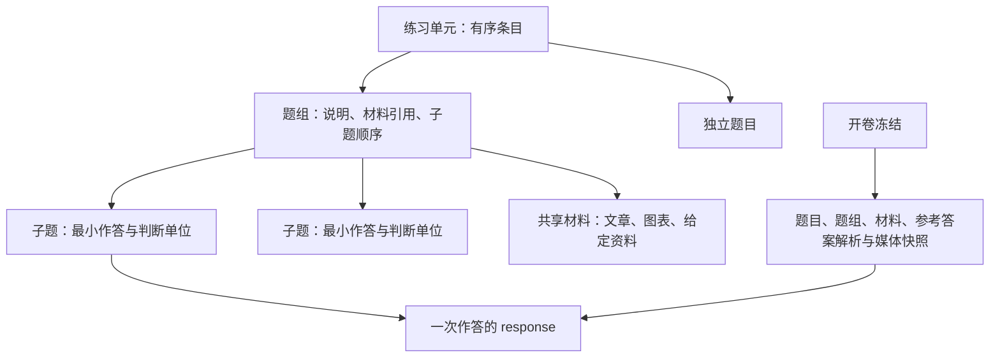

# 考研、考公题目存储、渲染与既有功能适配计划

日期：2026-10-23。状态：依据用户补充修订，待确认后实施。本次只修改计划；业务代码、契约、数据库与 DSL 尚未变更。

## 1. 修订目标：先把题目处理完整

2026-10-23 用户补充决定：本任务核心是题目的存储、渲染与现有功能适配。开放题、填空等由学生自评、教师评或 AI 评，不再依靠答案字符串或数学表达式自动匹配。有参考答案时，默认在完成作答且答案获准公布后，供学生对照参考答案和解析选择对错。具体 AI 怎么评、教师如何详细打分暂不展开。

本轮交付：共享材料、题组/子题、开放作答、匹配与排序的交互和答案结构、稳定身份、依赖快照、统一渲染，以及练习/作业/讲练/记录/错题/原稿/导出/AI 求助适配。

评判只实现必要闭环：提交后对照答案与解析，学生选择“对了 / 错了”，也可暂不判断，保存来源和版本。教师沿用后台评选入口；AI 评判作为后续可接入方式，具体算法和工作流不进入本轮。不建设卷面分、步骤分、部分分、评分量表或通用评分引擎。

原单选、多选、判断沿用已有自动判定，不扩展规则；填空不恢复自动匹配。solve/apply/find-error 的新作答也停止最终答案等价比较，与开放题一样转为对照评判；历史判定不重算。

“完成作答”与“已经判断对错”独立：可以先交答案，之后阅读解析和自评。没有参考答案或尚未自评时，仍保留完整作答、原稿和记录。

题型保留原七种，新增三个底层交互类型候选：response（开放作答）、matching（配对）、ordering（排序）。matching 是学生使用的配对控件，不是自动匹配答案的评分算法。阅读理解、资料分析、完形和多问解答用题组结构表达；考试领域用标签。

首批覆盖书面题。面试录音、听力播放、代码执行、自动作图判定不进入本轮。

## 2. 事实依据与现状缺口

本轮检查源码、架构文档、现存样例和相关测试；没有读取用户业务数据库，没有进行浏览器视觉验收或 Pencil 真机验收。

### 2.1 已有能力与证据

| 领域 | 当前实现 | 对扩展的意义 |
| --- | --- | --- |
| 题型 | `packages/contract/src/content.ts`：judge、choice、multi、fill、solve、apply、find-error | 题型混合了交互方式与教学名称；继续按考试章节增加枚举会扩大分支数量 |
| 答案 | `content.ts`、`grading.ts`：布尔、索引、索引集合、按序填空、final 字符串 | 适合简单题；缺少长文、匹配槽位与排序项表达 |
| 内容存储 | `apps/server/src/db/schema.ts` 的 questions：原文 + 抽取字段，主键为教师域内题目 ID | 保留原文是真相与教师隔离；结构化字段继续由解析器生成 |
| 题目归属 | questions.unitId 单一归属；同教师同 ID 重导会更新归属 | 不是可任意复用的“题库题目—多份试卷”关系；同 ID 跨卷导入可能移动题目 |
| 练习导入 | `packages/md-dsl/src/v2/parse.ts` 的 parsePracticeDocument 只提取顶层题块，Unit 只有 questions 等字段 | 题块外公共正文没有独立材料存储位置；把阅读文章写在题块外不能得到完整材料题 |
| 题块解析 | `v2/question.ts` 只认顶层 question；`directives.ts` 指定 allowedIn=document | 直接嵌套 question 不是现成的复合题支持；lesson 更有禁止嵌套的安全规则 |
| 冻结 | responses.questionSnapshotJson 在开卷保存完整 Question；responses.id 同时是 questionRevisionId | 单题历史可靠；扩展时必须冻结材料与组结构，不能只加 live materialId |
| 判分 | `packages/grading/src/grade.ts` 返回 boolean 或 null | 可复用简单对错；本轮仅补自评与来源，不细化分数 |
| 填空 | capability.ts 把 fill 声明为 rubric，grade 直接返回 null | 全人工是 2026-10-02 已确认决策，不能因扩展顺手恢复自动判分 |
| 解答 | solve/apply/find-error 共用最终答案等价比较；无可比较答案时待批 | 新作答停止等价比较，转入参考答案对照与简单评判 |
| 得分 | attempts.scoreAuto、scoreFinal 为按题数计算的整数百分比 | 本轮沿用已有百分比语义，不建设卷面分或权重体系 |
| 呈现 | QuestionSurface 处理判断、选择、内联填空；FinalAnswerInput 为单行文字/数学输入 | 有成熟题面与手写基础，但缺少长文编辑与材料对照工作区 |
| 媒体 | RichMarkdown 共用 GFM、KaTeX、清洗管线；::image 与媒体服务已有本站内容寻址图片 | 图文题不是从零开始；重点是长表、选项图、放大、导出和材料关系 |
| 错题重练 | `services/wrong-practice.ts` 从来源 response 复制题目快照 | 目前快照不包含独立共享材料；引入引用后必须一并复制依赖闭包 |
| 能力注册 | capability.ts + grading/validator-registry.ts | 有扩展入口；非 exact 题型仍强制 validatorId 的已登记技术债会被新主观题放大 |

### 2.2 两类需要明确区分的问题

**能显示不等于支持题型。** 把申论作文题写进 apply，或把资料复制进五道 choice，可能暂时显示，但材料修订、逐题记录、错题重练和导出都会产生额外问题。

**已有预留不等于已实现。** validation.shape 包含 partial 词表，当前多选实际仍是全对才对；不能把架构文档的“可配置部分得分”当作已有功能。部分旧注释仍保留填空自动判分表述，实施时要同步清理，具体行为以最新决策与测试为准。

### 2.3 考试场景的外部核对边界

- 国家公务员局发布、国家林草局转载的[2026 年公共科目大纲](https://www.forestry.gov.cn/c/www/gsgg/645383.jhtml)覆盖文字、图表资料分析与申论材料场景。本计划借此核对材料组织需求，不把某年题量或经验分值写成系统默认规则。
- 研招网自有文章[英语一与英语二的区别](https://yz.chsi.com.cn/kyzx/bkzn/202506/20250618/2293390155.html)列出知识运用、阅读、翻译与写作，并区分语句与段落翻译。该文更新于 2025 年 6 月，不能据此声称已验证 2027 年全部题型细则。
- 国家金融监督管理总局[2027 年专业科目大纲](https://www.nfra.gov.cn/cn/view/pages/ItemDetail.html?docId=1274950&itemId=925)明确专业科目包含单选或多选，说明“考公只需要单选”的模型也不完整。

以下优先级是针对本项目的产品与工程判断；匹配、排序等按可服务的训练形式设计。本轮按训练内容结构设计；各年题量/分值模板和计分规则暂不建设。

## 3. 需要补充哪些题型

| 优先级 | 用户看到的题型或场景 | 推荐底层表达 | 必补能力 |
| --- | --- | --- | --- |
| P0 | 行测资料分析、英语阅读理解 | 共享材料 + 多道 choice | 材料引用、题组顺序、材料对照、子题独立保存与统计 |
| P0 | 申论归纳概括、综合分析、提出对策、贯彻执行 | 多材料 + response，教学标签区分任务 | 多材料选择引用、中文计数、长文/手写、参考答案与解析、字数提示 |
| P0 | 英语句子/段落翻译 | 材料片段 + response | 稳定段落/句段锚点、译文编辑、多个参考表达、对照阅读与自评 |
| P0 | 申论文章、英语应用文和议论文、管综写作 | response，标签 essay 等 | 标题/正文、段落、中文或英文计数、参考解析、长稿分页 |
| P0 | 数学计算与证明、政治分析、专业课多问解答 | 共用题干/材料 + 独立子题；计算可沿用 solve，证明使用 response | 子题编号、手写证据、独立判断、父题不重复计题数 |
| P0 | 完形填空 | 一份带槽位的文章 + 多道 choice | 每空独立选项与答案；空位 ID 对应子题，不用含答案的 [[…]] 表达选择空位 |
| P1 | 七选五、段落补全、小标题匹配、信息配对 | matching | 公共选项池、slotId → optionId、选项是否可重复、干扰项、参考答案对照 |
| P1 | 段落排序、步骤排序 | ordering | 稳定项目 ID、固定位置、可选干扰项、键盘/按钮排序、参考顺序呈现 |
| P1 | 不定项选择 | 现有 multi | 正确表达选项与参考答案，不新增部分分规则 |
| P1 | 数学/词汇填空专项 | 现有 fill + 逐空输入与对照 | 空位身份、本人答案与参考答案对照；不做自动匹配 |
| P1 | 图形推理、图表选择 | 现有 choice/multi + 图文布局 | 图片选项、等尺寸预览、放大、高清底图；无需新建 picture-choice 类型 |
| P2 | 名词解释、论述、案例分析、设计题、算法书面题 | response + 标签/材料/题组组合 | 复用主观题基础，按需要增加答题模板；算法书面题不执行代码 |

不要把“政治理论、常识判断、数量关系、定义判断、类比推理”等都做成底层题型：它们主要影响检索、教学模板和统计，通常没有新的答案数据结构。

## 4. 内容模型：材料、题组、题目分层



### 4.1 建议新增的契约概念

所有正式类型从 packages/contract 的 Zod schema 推导；下表是设计，不是可直接提交的 TypeScript 或已发布 API。

| 对象 | 关键内容 | 约束 |
| --- | --- | --- |
| Material | 稳定 ID、版本、标题、Markdown 原文、公开段落锚点、媒体引用 | 教师域内管理；原文不混入参考答案、解析或教师私注 |
| QuestionGroup | 稳定 ID、公共说明、材料引用、子题 ID 顺序、显示编号、提交/释放范围 | 首版仅一层；父组不创建作答行、不重复计题数；不能循环引用 |
| Question 扩展 | group 引用、材料片段引用、任务标签、来源元数据、作答配置与最小评判方式 | 旧字段保留；新增字段可选并有明确兼容默认；标题编号与真实 ID 分开 |
| Unit 结构 | 独立题/题组的有序条目 | 一个组完整出现一次；同一道题在同一 attempt 只出现一次，沿用现有唯一约束 |
| OpenResponse | 正文；可选标题等命名字段；正式手写继续走已有证据协议 | 文字与笔迹可以共存，不把矢量或 PNG 编码塞入 answerJson |
| MatchingAnswer | slotId 到 optionId 的映射 | 检查未知 ID、重复占用、遗漏；允许重复选项必须显式配置 |
| OrderingAnswer | 有序 itemId 序列 | 固定项、未填槽、干扰项规则明确；不得用排序后的文本当唯一身份 |
| ReviewRecord | 简单对错、判断来源、更新时间与版本 | 未判断与错误分开；自评不伪装为教师或自动判定 |

题目完整性校验分两层：解析结果允许表达有问题的文档；进入持久化、发布和冻结前必须通过严格的可发布校验。校验 type 与答案形态、选项索引、材料引用、子题归属和答案结构，不只验证单字段类型。

### 4.2 三个贯穿示例

**资料分析五小题**：一份 material 存文字和统计表；一个 group 引用该材料及五道 choice。界面共享材料，服务端保存五个 response。改材料只影响之后的新卷；重练第三题时带上该题必需的原材料，不自动加入其余四题。

**完形填空二十空**：一份文章包含二十个稳定槽位，槽位映射二十道 choice；每道题的选项互相独立。文章里的编号是显示信息，增删其他空位不能串改既有答案。若二十空共用一个词库，才改用 matching。

**证明题含两问**：组说明存公共条件；两问分别是 response，各自有答案正文、参考解答和正式手写。子题分别记录自评/教师判断；公共解析涉及其他题答案时延后释放或拆分题级解析。

### 4.3 身份、引用与检索

- 新材料、组、槽位和选项采用稳定 ID；展示编号如“材料 2”“第 36 题”“（1）”单独保存，不做主键。
- 旧 choice/multi 的索引答案和旧 fill 的顺序数组保持解释不变；匹配/排序从第一版使用 ID。旧内容升级只影响新发布版本，不能重编号历史答案。
- 新复合结构的稳定 ID 在导入规范化时生成并回写规范化源文；重排不重新生成。新文档显式 ID 优先。既有“单元-序号”缺省规则不改义。
- 元数据建议含考试方向、科目、年份、地区/卷别、来源说明与原题号；未知留空，不由 AI 推断成事实。不同来源可能同名同题，不能仅按题干哈希自动合并身份。
- 首版沿用“一题归一个单元”，组内子题必须属于同单元。同 ID 跨单元重导在预览中清楚提示移动及引用影响。多试卷复用另做关联表迁移，避免首批同时重写整个题库归属模型。

## 5. 存储与冻结方案

继续使用 SQLite、Drizzle、JSON 文本列和现有 blobs，不需要更换数据库或新增渲染框架。

### 5.1 推荐落点

| 存储 | 建议变化 | 理由 |
| --- | --- | --- |
| questions | 增加可选结构/作答/来源字段；高频筛选字段使用可索引列，其余由契约校验的 JSON | 保留现有 ID、版本、源文、软删和快照链路；不按每个考试题型建表 |
| materials（新增） | 教师域、稳定 ID、版本、sourceMd、抽取正文/锚点、软删与更新时间 | 内容去重与复用；原材料身份不依赖一张试卷 |
| question_groups（新增） | 教师域、组 ID、unitId、版本、组源文与抽取的说明/引用 | 让多问结构可编辑、可重导、可验证 |
| 组成员/材料引用索引（新增） | 从源文抽取成员与引用关系；关联键含教师域 | 用于缺失引用检测、删除影响和组卷查询；不是第二份人工维护的真相 |
| units | 可选有序结构清单及其规范化结构源文 | 只描述顺序和引用，不再复制题目或材料正文；旧单元缺省仍用原题序 |
| attempt_context_snapshots（新增） | 按 attempt 保存组与材料的冻结内容、版本及引用；同一材料同版本一次存储 | 避免每道子题重复一篇长文章；不能仅引用 live materials |
| responses | 保留原行 ID、旧快照和 CAS；新增可选上下文引用与简单判断来源 | 不 DELETE/重插，不改变 questionRevisionId 的既有含义 |
| 媒体文件 | 继续 blobs/media 内容寻址；补齐冻结依赖、备份与清理引用关系 | 历史卷与复习包不能因当前题目删除而缺图 |

以上表名为候选，第一阶段须结合查询和迁移测试确定最终 DDL。关系表用于可查询的引用，版本化 JSON 用于内部结构，避免两种极端：所有内容塞进一个不透明 JSON，或每种考试变体新增一组表。

### 5.2 保持“原文是真相”

1. question.sourceMd、material.sourceMd、group.sourceMd 各自是该实体的作者源文；单元结构源文只列顺序与引用，不重复正文。
2. 导入、编辑、reparse 必须经过同一组解析与写入函数，结构化字段不接受绕开原文的独立手工修改。
3. 批量文档解析两遍：先收集所有实体，再解析引用，允许向后引用；整个批次验证成功后事务提交。
4. 发布后编辑材料或组需要版本检查，预览受影响内容；只改当前资源版本，不回写已冻结作答。
5. 旧 practice 题块外曾被忽略的文本若数据库未保存，不能凭空恢复；需从教师原始 Markdown 重新导入。迁移报告明确列为无法自动还原的数据。
6. lesson 的原位题块与单题 sourceMd 仍沿用原同步机制；新材料/组的嵌入须在专门适配阶段进入，不能借本计划放宽现有嵌套规则。

### 5.3 冻结必须覆盖依赖闭包

一次开卷在同一事务读取并冻结：选中题目、相关组结构、必需材料与锚点、选项/槽位身份、参考答案与解析、题序、显示编号、媒体哈希引用。

材料快照和 responses 同时成功才算开卷成功。冻结后显示、判分、AI 组装、导出、错题重练只读快照；不允许出现“题目用旧版、文章用最新版”。缺失或损坏引用显式报错，不拿当前题库替补旧证据。

错题重练复制来源作答的**该子题及必要材料/说明**，默认不复制兄弟题的答案。若题目声明必须整组完成，选入整组前展示扩展范围，并复制完整组。新卷获得自己的 response ID 和 CAS 基线。

同一道错题与另一题来自不同历史作答时，材料可能同 ID 不同版本：冻结存储与前端 key 必须包含来源版本/快照身份，不能按 materialId 合并覆盖。只有内容与版本一致的依赖才可去重。

### 5.4 迁移纪律

- 先扩展 Zod，再执行 drizzle-kit 生成迁移；不手改线上库，不为本计划直接运行数据迁移。
- 先加可空列/新表，再做幂等回填与读兼容；历史 Question 快照仍可由旧形态解析。
- 旧卷不重判、不补造材料、不把百分比反推为真实卷面分；保留 legacy_unverified 的真实性边界。
- 结构快照与判断记录显式携带版本；新代码读旧形态，未知新版显式提示不能处理，不能降级成空题继续交卷。
- 部署先更新服务端读写能力，再开放新导入/新前端；有新数据后不能直接回滚到不能读取它的旧服务端。回滚预案是关闭新内容创建、保持兼容读服务，必要时按维护窗口恢复成套备份。
- 备份恢复测试包含新表、材料图片、进行中作答和历史快照；任何清理都保留当前引用、历史作答和备份引用。

## 6. 简单评判与既有状态适配

### 6.1 默认学习流程

填空、开放题和解答类默认：**填写/书写 → 保存并提交 → 按既有公布规则展示参考答案与解析 → 自选“对了 / 错了”，或暂不判断 → 更新结果与记录。**

自评是学习分析的一部分，不要求老师再次确认才生效。无参考答案时显示“暂无参考答案”，允许暂不判断和教师后续判定；不自动判错、不伪造答案。本轮不新增 AI 评分队列，不自动外发；将来 AI 评判可使用同一份题目、解析、本人答案和原稿，具体协议另行设计。

### 6.2 最小状态与权限

| 情况 | 展示与处理 |
| --- | --- |
| 已填未提交 | 保留草稿，不允许用自评接口获取答案 |
| 已提交、未公布 | 已完成作答、等待公布；不提前对照自评 |
| 已提交、已公布、未评 | 待自评，展示答案、解析与自评入口 |
| 学生选择对/错 | 标注“自评正确/自评错误”；本人可以修正自评，写入有版本检查 |
| 教师给出判定 | 标注教师判定；迟到自评不能覆盖教师判断 |
| 后续 AI 判定 | 明确标注 AI 来源；覆盖顺序、权限、复评在 AI 接入时定义，本轮不预设 AI 必须教师确认 |
| 无参考答案或暂不判断 | 已完成作答、尚未判断；不自动当作错题 |

待学生自评与待教师处理分别计数和展示，不能把所有 finalCorrect=null 的新自评题无条件塞入教师必批队列。完成作答不以自评完成为前提；尚未判断也能回看、订正、补评。全部判断后的已评完成态与现有状态机统一适配。

### 6.3 最小持久化与兼容

保留简单对错，增加必要的判断来源、时间与版本。学生自评不写 teacherMark；历史 autoCorrect、teacherMark 按原事实展示。具体如何兼容 finalCorrect 与待批共享谓词在契约阶段定稿，不提前另建评分平台。

服务端验证本人归属、已提交、公布权限、题目和写入版本，再保存自评。这里保存的是本人声明，不能伪装成客户端自动计算的可信成绩；服务端继续裁决状态与权限。

结果、错题本、记录、教师学情共用有效判定投影。自评错误进入错题集合，改为自评正确后更新当前集合，同时保留原作答和原稿。未判断不算错，来源始终可见；自评正确不能被描述为证明独立完成。

教师后台沿用评选/改判入口；改判、清除与迟到自评需明确优先顺序和并发检查，事务内刷新结果及错题统计。重复提交幂等，跨设备旧版本不能覆盖新判断。

旧百分比字段不改成考试卷面分；若汇总纳入新自评结果，文案与未判断数一起适配，不把自评正确率表述为自动测评事实。

fill、solve、apply、find-error、response 的新作答全部走非自动判断能力；matching/ordering 不新增答案比对器。旧选择/判断的已有自动能力保留，接口与状态仍统一。先补“即使有最终答案也不自动匹配”的失败测试，再修改旧解答类实现。

## 7. 渲染与作答工作区

### 7.1 共用渲染入口

保留 RichMarkdown、KaTeX、现有图片与清洗管线，QuestionSurface 继续负责题面。增加题组/材料容器、开放作答控件、匹配控件和排序控件，建立有限的题型能力映射，统一给出编辑、只读、静态导出、完成度判断入口。

这不是任意插件运行系统：不允许运行导入文档携带的组件代码，不给 Markdown 开放任意 HTML/SVG/脚本。选择类图文题复用已有渲染，复杂扫描表格可以使用本站高清图片，普通表格优先保留可读文本。

同一题数据经过教师预览、学生作答、结果、教师批改、圈画底图、PNG 和 AI 材料时，应有对应模式，不能在每处重新解释新题型。新增类型遗漏任何必需模式，在开发与测试期明确报错。

以代表性长材料先测量再确定预算：每篇材料字节/段落数、每组子题/槽位数、每卷依赖总量、图片像素和导出页数分别设上限；引用解析与冻结按集合批量读取，避免每题重复查询同一材料。初始响应中的材料去重，正文按需要挂载；不得为了虚拟滚动卸载尚未落盘的答题或手写控制器。超过预算给出具体错误，不以截断正文换取成功。

### 7.2 材料与问题的空间关系

- 宽屏：在可用容器宽度足够时材料与当前子题对照；AI 和手写打开后重新计算可用空间，不能固定变成四列窄条。
- 窄屏：默认一个阅读流，材料有明确的打开/收起和“回到本题”；切换保留材料滚动位置与子题草稿，不强制跳回材料顶部。
- 多材料：显示材料编号、标题与当前题引用范围；不要把所有材料压成一个无定位的巨长题干。
- 表格：表格区域横向滚动，不能让整页横向溢出；打印和图片导出采用独立分页版式。
- 图片：提供可放大查看、加载失败重试和替代文本。显示缩放不改变原图与标画的逻辑坐标。
- 单题专注按“当前子题＋依赖材料”展示，列表按组展示；两者共用控制器和保存状态。

### 7.3 开放作答

首版用现有 React 控件实现多行正文，允许普通文字/受限 Markdown 与数学表达，不引入新的富文本编辑器。与正式手写共存，不要求作文输入单行“最终答案”。

中文按明确计数字符口径，英文按明确单词口径，并展示统计说明；字数区间通常作为提示，除非教师明确配置硬限制，不在保存时截断长文。标题和正文是否分别计数由作答配置决定。

长文沿用逐题 CAS、mutationId、角色缓存隔离和迟到回执防护；匹配/排序也作为本题答案整体保存。发生同题冲突时显式选择版本，首版不做自动合并两篇文章。输入法组合输入、粘贴长文、撤销、离线恢复都需测试。

### 7.4 共享材料圈画是独立工作项

现有标画键围绕题目，不可把“材料 ID”伪装成一道题。首批材料题可以只读共享材料，子题继续拥有原有草稿和标画；界面应明确共享材料尚无圈画入口，不能复制成多份不一致材料。

完整材料工作区再增加显式 evidence target：question 或 material。材料标画按 attempt、materialSnapshotId、phase 隔离；布局指纹、底图、CAS、撤销、封存和导出沿用现有纪律。先补 target 契约再改相关存储，不能只改前端缓存键。

共享材料可能跨多个已提交子题：建议在各次提交证据中引用当时不可变的材料标画版本，编辑头可供后续子题继续使用；整组/整卷完成后锁定编辑头。以前提交的证据不能因为后续圈画改写。该版本引用方案必须专门验收后才开放材料圈画。

### 7.5 导出与长内容

“导出本题”包含完整公开题干和必需材料，再包含该题原有笔迹/草稿；不能只有“根据材料回答”而没有材料。整组导出可把材料放一次并附清晰交叉索引；单题包必须可独立阅读。

长材料按段落、表格/图片边界分页，重复必要标题和页码。超大图/表不能默默裁掉；需缩放、拆页或明确失败。沿用已挂载导出副本收集字体、固定矢量重绘、保存失败不遗漏材料的规则。

## 8. 公布、自评权限与安全

默认自评仅在已提交且答案获准公布后可用；作业截止后公布、讲练当题公布与 AI 教学策略分别沿用原权限裁决。新增学生自评接口必须验证归属、提交态、公布态与版本并加泄露测试。

### 8.1 三套投影不能混用

1. 教师完整内容：参考答案、解析等完整形态。
2. 学生公开内容：公开材料、题干、选项、作答约束；不含答案映射、未授权解析/提示、私注与原始题块。
3. 受控 AI 出口：只在既有三出口和当前教学策略允许时加入本题答案解析；增加必需公开材料，不自动加入整组其他题目的答案。

每种新对象都有显式公开白名单，不从完整对象删几个键。材料作者正文、图注和图片替代文本也会成为外发内容；导入时检查其中的答案型指令、隐藏题块和错误放置的解析，不能认为“materials 表里的内容天然安全”。语义上写进图片或普通正文的答案无法靠键名过滤完全识别，应由教师导入预览核对，不能宣称自动防泄露覆盖这种情形。

### 8.2 一题提交不应打开兄弟题答案

- 独立小题允许题级提交/释放；组级解析可能透露其他题答案，默认等组内要求的题全部提交后再释放。
- 不给所有材料题默认增加组级提交。优先复用既有题级/整卷语义；公共组解析若透露未提交兄弟题答案，应延后公开或拆成题级解析。确需整组作答的结构再明确其事务提交范围。
- 选择“组内全部提交才释放”并不意味着学生公开接口可以提前返回答案；读取、缓存和导出仍逐次执行服务端 gate。
- 普通作业继续服从整卷公布/截止公布约束；新题组策略只能收紧当前允许范围，不能绕过教师策略。
- lesson 的当题提交即释放语义保留，通过安全 blocks 与题级解析适配新材料/子题；如出现不能兼容的组结构，实施前明确处理方案，不能把最终不支持讲练当作交付。
- AI 完成态与普通公布独立。组策略新增后须明确当前子题何时算完成，继续使用既有三教学模式，不因共享材料解锁未完成兄弟题。

新增接口与材料读取全部加归属测试和 assertNoLeak；受控 AI 出口继续双断言，不改全局禁止键规则。

每个阶段都要盘点新内容的所有消费者。尚未适配的新类型 AI 求助、讲练或特定导出入口须由服务端能力检查明确拒绝，并在界面说明，旧类型继续可用；不能等 E4 才补前面阶段已经开放接口的安全投影。E4 负责能力补齐与最终验收，安全门槛随每次开放同时交付。

## 9. DSL 扩展与兼容策略

建议只增加材料声明、题组声明、显式引用与槽位等有限指令，题块继续保持顶层。组声明引用子题，不在 question 中直接嵌 question，因此不破坏 lesson 的既有安全前提。

具体语法在第一阶段用短、中、长三组样例评审后定稿；本计划不提供看起来可导入、实际尚未注册的新 DSL。必须按“注册表 → 组件 → 样例测试 → pnpm gen:spec”交付。

新增属性可选，旧文档缺省行为不变。无法识别的新显示指令保留项目既有优雅降级，但如果缺失能力会丢材料、丢作答或误判分，则导入/发布应阻止并说明所需版本，不能只渲染占位后继续考试。新旧能力清单应描述已实现能力，不能提前宣称可导入新题组。

核心 lint：缺失引用、跨教师引用、循环/嵌套组、重复子题、组外子题混入、槽位重复/丢失、选项 ID 不合法、公共材料含私有指令、引用范围超过材料边界。

## 10. 分阶段实施与文件清单

每阶段独立 codex/ 分支，先测试再实现，执行质量闸门和真实验证后按 v2→main 合并。本次修订计划不代表开始开发。

### E0：内容契约与兼容样例

交付：材料、组、原子答案、最小自评记录、来源与状态；至少八类完整语料。明确已提交/已公布/待自评/已判断如何映射到旧状态，禁止将新类型接受与实现完成混为一谈。

文件：contract 的 content.ts、grading.ts、attempt.ts、capability.ts、directives.ts、教师/学生结果和记录契约；新材料/组契约及测试；samples 与架构文档。

测试：旧快照、旧题型、公开投影、引用完整性、非自动能力一致。validatorId 非自动死桩仅按本轮所需处理并保留清单兼容，不另开通用评分重构。

### E1：材料题全链路

交付：资料分析/阅读理解的共享材料与子题可导入、存储、作答、回看、导出与重练。先使用已有 choice 打通链路。

文件：md-dsl parse.ts、question.ts、新 material/group 解析与 lint；server schema.ts 与生成迁移，content-service、question-sync、reparse-service、snapshot、attempt-service、wrong-practice、媒体/备份/导出；web 材料/组容器和题卡。

测试：一材料五题、缺失引用、两教师同 ID、开卷后改材料、单题重练、同材料不同历史版本、手机长表、媒体恢复。按第 10.1 节检查所有入口，不能只验证教师预览。

### E2：开放作答与简单自评

交付：翻译、申论、作文、证明的长文/手写；填空和旧解答题停止自动匹配；有答案且公布后默认自评；原教师评选可用；结果、错题、记录、待处理同步。AI 具体评判不在本阶段建设。

文件：contract 答案联合、自评请求、结果来源；grading grade.ts、validator-registry.ts；server 作答/自评路由、投影、pending-mark、教师改判、记录/错题/统计；web QuestionSurface、开放作答/自评控件、question-completion、草稿同步、结果和教师详情。

测试：先补旧解答类不自动匹配用例；不同等价填空不自动判；提交/公布前拒绝自评；无答案、暂不判断、重复自评、跨设备修正、教师已判后的迟到自评；错题集合刷新；未评不算错、完成不被自评阻塞；长文输入法和手写恢复。

### E3：完形、匹配、排序与讲练适配

交付：稳定文章槽位、共享选项池、排序序列与参考答案表示；可作答、保存、对照和自评；lesson 的安全 blocks 能承载材料/组和冻结子题。

文件：contract 答案联合与保存请求，md-dsl 槽位/选项池解析和 lint；server 保存/提交/安全投影与 lesson；web 新控件、完成度、只读/导出与讲练卡片。不新增答案匹配判分器。

测试：二十空不串答、选项重复限制、固定项/干扰项、键盘操作、非法 ID、兄弟题答案不泄露、讲练刷新/重开幂等、最后一题收尾、嵌入单元过滤继续成立。

### E4：全部既有功能验收与体验收口

交付：第 10.1 节矩阵全部通过，长材料/长稿、手机/iPad、AI 上下文和备份恢复适配；共享材料圈画如开放，必须完成独立目标及不可变证据。考试来源筛选保留必要字段，多试卷复用和官方分值模板不作为本轮前置。

文件：annotation/export/ink/lesson/AI workspace，材料/证据/复习包契约与服务，backup/GC、E2E 和文档。安全投影随各阶段开放同时交付，不推迟到本阶段。

### 10.1 既有功能适配矩阵：核心完成条件

| 功能 | 必须适配 |
| --- | --- |
| MD/ZIP 导入、预览、重导、编辑、reparse | 结构完整、材料不丢、ID 稳定、媒体随包、往返一致 |
| 资源库、课程、布置作业 | 组与子题数量正确，材料/父组不计作可答题，嵌入单元过滤不退化 |
| 课程练习、作业、错题重练 | 共用 AttemptSession 与保存协议；子题完整上下文；教师约束、来源返回保留 |
| lesson 讲练 | 原位混排、安全 blocks、当题提交/锁定、最后一题收尾；不放宽嵌套题禁令 |
| 列表/单题专注、题号导航 | 子题可定位，编号与身份分离，切换保留草稿和阅读位置 |
| 草稿、正式手写、标画、跨设备同步 | 复用落盘/恢复/CAS/封存；保存失败保留现场 |
| 结果、本题历史、订正 | 来源版本材料、本人答案、获准答案解析与判断来源完整；控制器不丢状态 |
| 记录、错题、学情 | 统一有效判定，未判断不算错，自评来源明确，重练带材料 |
| 教师详情、后台评选、待处理 | 完整题目/原稿可读；待学生自评与待教师处理分开；改判同步 |
| 导出、复习包、CSV | 单题可独立阅读、媒体和长内容完整、来源可辨、答案按权限 |
| AI 伴学、上下文链接、学生 MCP | 本题必需材料齐全，三教学策略和受控出口按当前状态裁决 |
| 备份、旧卷、手机/iPad | 新表/文件可恢复，历史快照可读，触控/键盘/布局可用 |

中间批次可明确限制尚未适配的新类型入口；最终不得以“暂不支持”替代核心适配验收。每种新题型都要走通“导入→布置/进入→作答→保存/恢复→提交→对照/判断→记录→错题重练→导出”。

## 11. 验收语料与质量闸门

### 11.1 必须贯穿全链路的语料

| 样例 | 必查内容 |
| --- | --- |
| 文字＋统计表＋五道资料分析 | 共享呈现、版本冻结、单题重练含材料、图片依赖 |
| 英语长文章＋五道阅读题 | 长阅读定位、选项换行、题级状态、材料对照 |
| 二十空完形 | 空位/子题身份稳定、相邻空不串答、组内结果释放 |
| 七选五/小标题匹配 | 共享选项池、干扰项、重复限制、键盘可用 |
| 含固定段落的排序 | 固定项、序列保存、只读回看和导出 |
| 多材料申论＋短答＋作文 | 多引用、字数、长文/长稿、答案解析对照与自评 |
| 数学证明两问＋计算小问 | 子题身份、共同条件、正式手写、旧解答题不自动比较 |
| 旧七题型混合练习 | 缺省字段、旧 fill 人工、旧百分比、样例解析与渲染一致 |

语料使用原创小型材料或明确授权材料；目标是覆盖结构与行为，不需要复制整套商业真题。

### 11.2 每阶段的门槛

1. 先写对应失败测试，涉及解析器/判分必须保留失败阶段证据，再改实现。
2. 本分支完整 diff 按项目要求依次做 simplify、code-review；触及学生载荷/答案加 security-review，确认问题修复或逐条说明。
3. 运行 `pnpm test`、`pnpm typecheck`、`pnpm lint`、`pnpm build`；DSL/契约相关执行 `pnpm gen:spec`，提交 docs/dsl、JSON Schema 和 dsl-kit 产物；检查再次生成无差异。
4. `pnpm tutor-lint` 检查新增有效样例；故意错误的样例断言准确错误码；现存 samples 全部继续参与回归。
5. 按阶段运行真实 `pnpm e2e <相关spec路径>`，Chromium/WebKit、隔离数据库与 8899/5199 端口。不能用用户正在工作的 5173 服务充当隔离测试。
6. 含数据迁移阶段验证空库、存量库、重复迁移、备份恢复，以及有进行中作答时升级；保存失败、缺图和坏快照显式呈现。
7. UI 阶段提供手机、桌面、iPad 分屏实测记录；Pencil 舒适度与手写坐标不能仅凭桌面测试宣称完成。
8. PR 写清楚手动验证步骤、迁移影响、历史语义及未覆盖项，全绿后按 v2 → main 合并。

### 11.3 原分析回合运行的基线

原分析轮没有实现代码变更，曾运行当时相关回归，以避免基于已经失效的假设制定计划：

```text
pnpm exec vitest run packages/contract/src/content.test.ts packages/contract/src/grading.test.ts packages/contract/src/capability.test.ts packages/grading/src/grade.test.ts packages/grading/src/validator-registry.test.ts packages/md-dsl/src/v2/sample-regression.test.ts packages/md-dsl/src/v2/student-stem.test.ts apps/web/src/features/attempt/sample-rendering.test.tsx

Test Files  8 passed (8)
     Tests  147 passed (147)
  Duration  7.22s
```

存在 Vite 配置加载方式的预警，不影响本次测试退出码 0。这是现状基线，不是新方案已经实现或验证的证据；本轮未运行全仓构建、类型检查、完整 E2E 或数据库迁移。

## 12. 与已有计划协同及完成标准

工作区已有 2026-10-22-student-practice-feedback-upgrade.md，关注逐题反馈与布局。两者复用 AttemptSession、QuestionSurface、保存/提交服务与公布裁决；材料、组、自评须与它协调，避免两套状态机。

完成标准：新题目和依赖材料处理完整、作答/原稿可靠、答案按规则可读、默认自评可用、教师原入口能处理，练习/作业/讲练/结果/错题/历史/导出/AI 求助完整适配，旧题旧卷继续工作。AI 怎么评与精细评分不阻塞这一目标，也不以占位入口宣称实现。

本次修订仅修改计划，未改业务代码、契约或数据库，未重跑上一轮测试。
