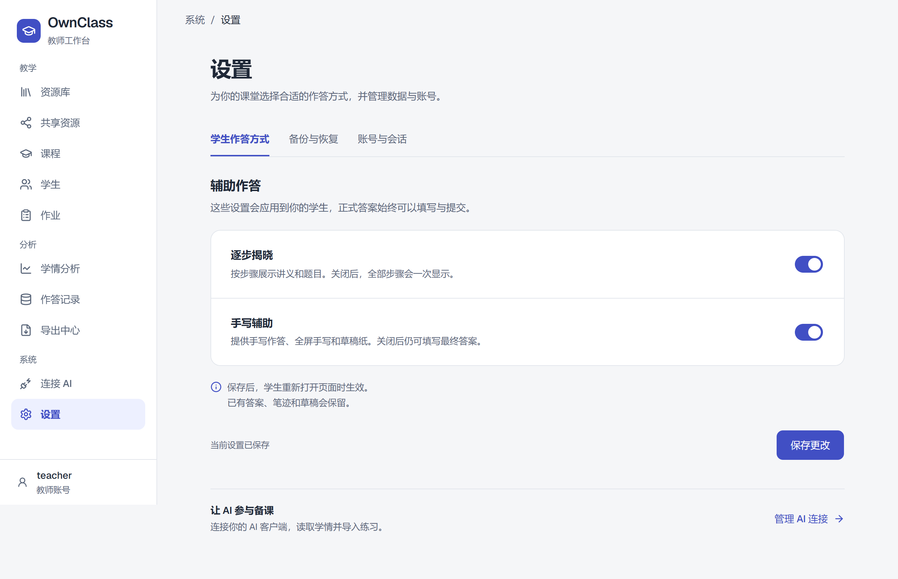
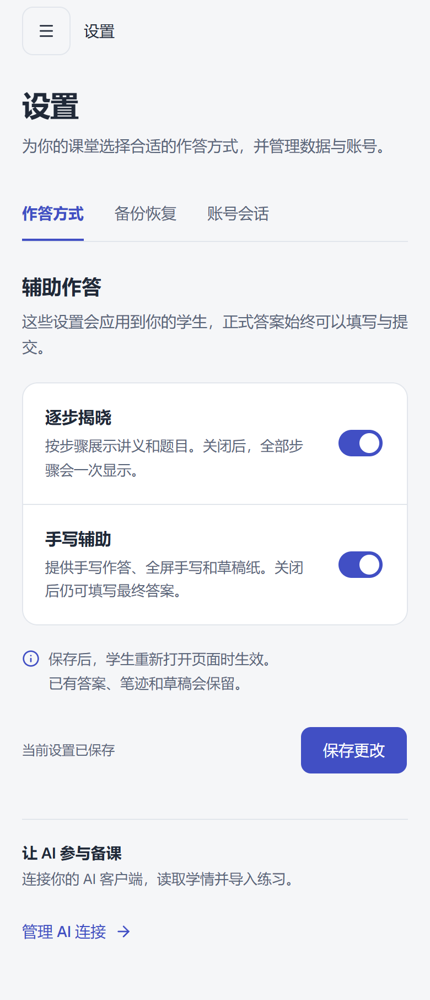
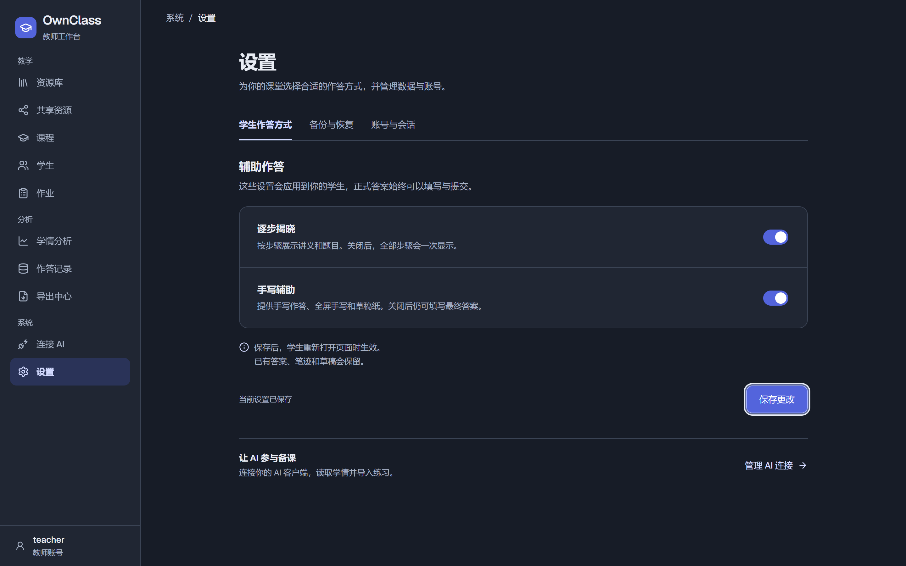
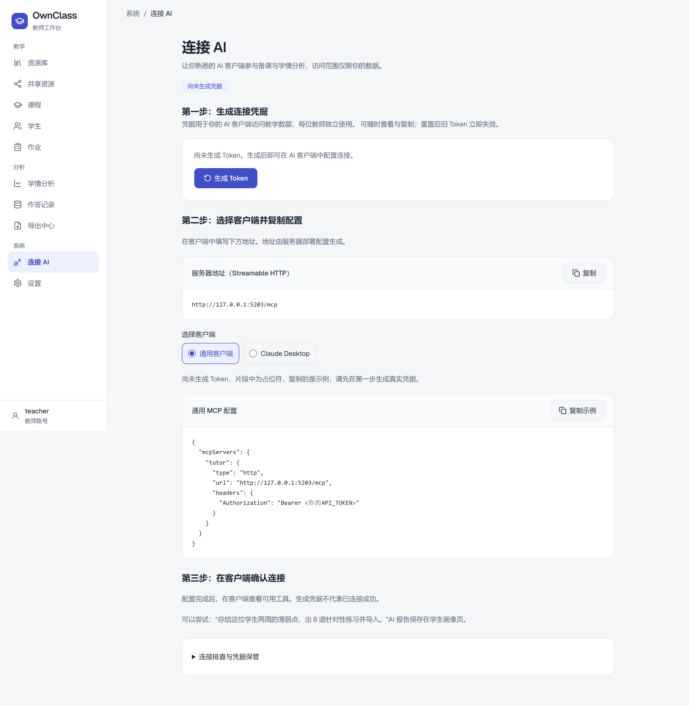
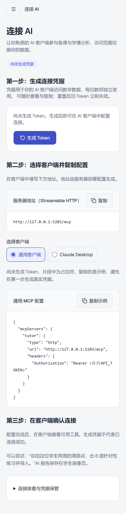
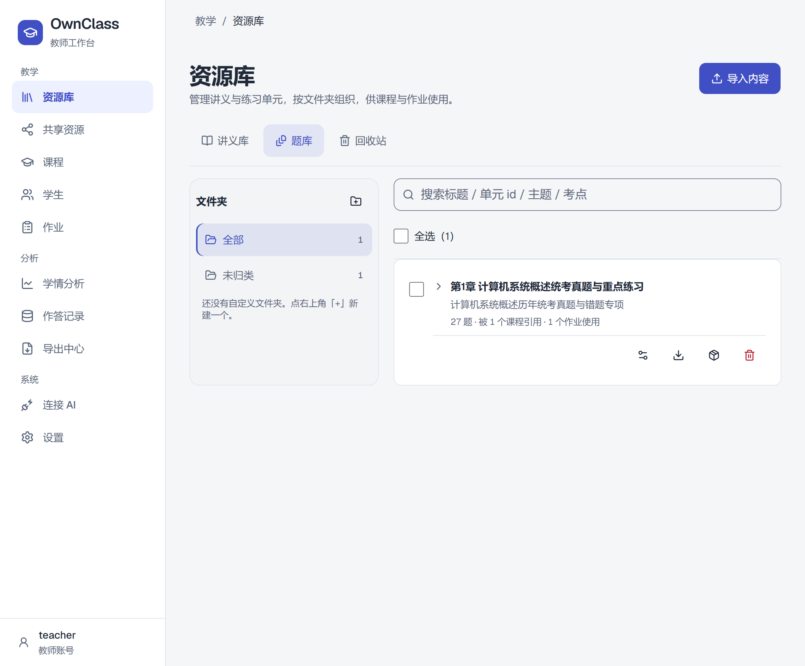
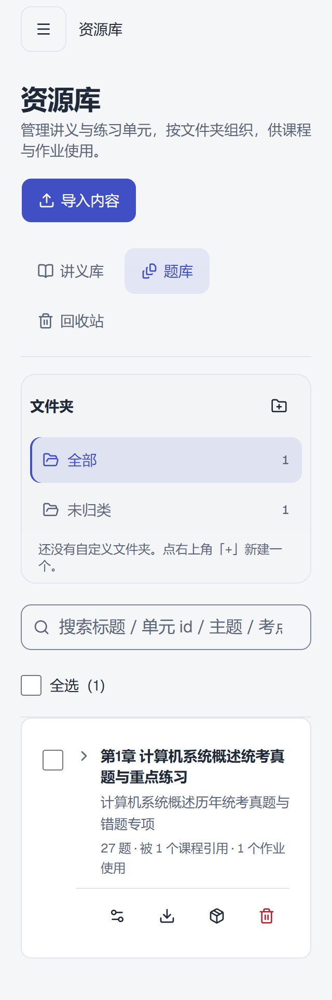
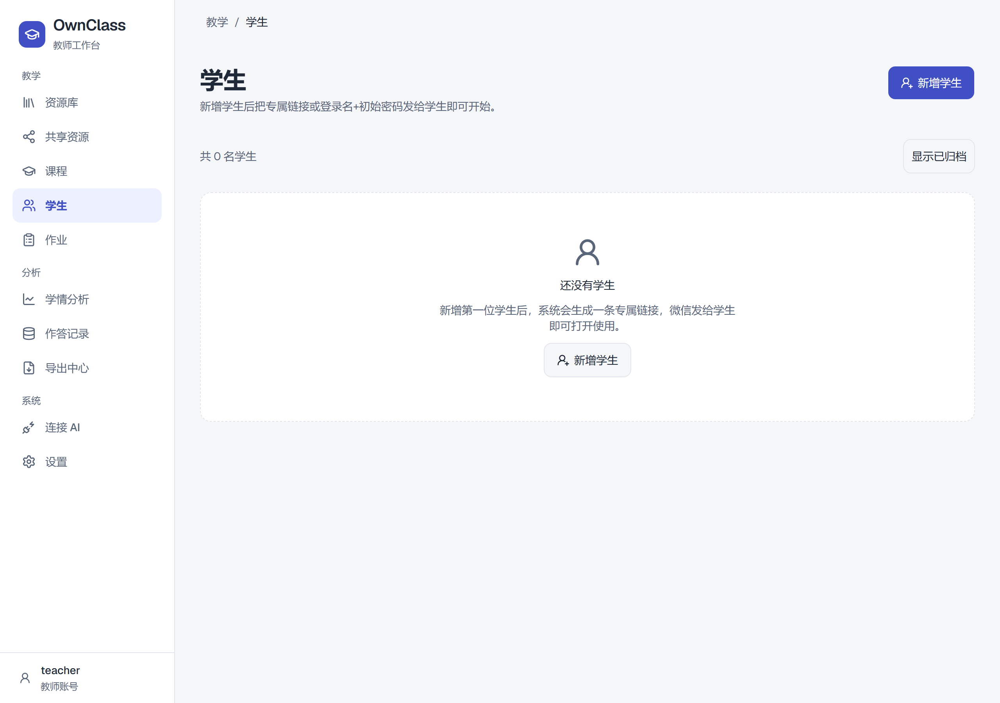

# OwnClass 教师端视觉重设计验收

日期：2026-10-12。实施分支：`codex/ownclass-teacher-visual-redesign`，基于 v2 `b50f07e`。用户已确认完整方案并授权实施、合并 v2。

## 实施结果

- 教师外壳：224px 白色侧栏、56px 顶栏、44px 导航项，靛蓝选中态；底部仅保留一个账号入口，管理员入口放入账号分类。
- 设置：取消第二层竖向导航和嵌套卡片，三分类改横向链接；两项作答方式使用统一配置行，显式保存并显示稳定状态。分类切换、后台重取、浏览器返回均保留草稿；普通离开与退出登录有放弃确认，刷新使用浏览器原生提醒。草稿只保留在当前 QueryClient，按教师 ID 隔离，退出清除。
- 备份：下载、最近快照、危险恢复操作按阅读顺序分区；原有文件、密码确认与恢复流程保留，快照错误增加重试入口。
- AI 连接：单列三步流程，凭据默认遮蔽、显式查看；未生成凭据的配置明确标记为示例；统一客户端配置面板，帮助折叠。接口和 MCP 配置键未改。
- 业务页面：统一标题、内容轴线、留白；资源卡片的标题和操作分行，长标题完整换行；学生、课程和作业空态按钮降为次操作，页面标题区保留主操作。
- 品牌为 OwnClass；登录页面与账号页保留准确广告词 `Your data. Your way. All for learning.`。
- 教师主题独立应用，弹层通过根主题继承；暗色强调文字与实心按钮使用各自前景角色。无新依赖、CDN、接口、数据库或 DSL 变更。

## TDD 与质量闸门

先补导航/账号入口、保存状态与草稿保留的行为测试，再实现。凭据默认遮蔽与“复制示例”新增断言先得到失败：`2 failed | 18 passed`，随后实现转绿。纯颜色、间距、字号与按钮外观按项目规则豁免 TDD，使用真实浏览器截图检查。

本机未提供同名 `/simplify`、`/code-review` 技能。按顺序完成等价人工简化审查与正确性审查，检查整个分支差异，而非声称调用了不存在的技能。

1. 简化审查：复用 Brand、Button、Radix Sheet/Dialog、现有查询与协议；共享页面类和色彩 token，未修改共享 Button 或另建配置类型；清除重复卡片、图标、步骤条与误改的回收站元数据样式。
2. 正确性审查：修复重取覆盖草稿、保存成功缓存短暂回退、跨账号草稿串用/过期、确认导航后抽屉未关闭、遮蔽凭据的手动复制提示、暗色链接对比度和重复主按钮。行为分别由单测与浏览器用例验证；未发现需保留的未解决阻断项。

未触及学生答案载荷或判分，未运行额外安全审查技能；全量现存样例回归随单测通过。

## 真实验证

命令均在隔离工作树运行，退出码为 0。全量单测完成后最后只修改强调文字颜色和空态按钮外观；补跑相关页面单测、类型/静态检查、构建及浏览器页面验收。

| 命令 | 实际输出 |
| --- | --- |
| `pnpm test --maxWorkers=4` | `Test Files 338 passed (338)`；`Tests 4034 passed (4034)`；302.93s |
| `pnpm exec vitest run --project web ...StudentsPage.test.tsx ...CoursesPage.test.tsx ...AssignmentsPage.test.tsx --maxWorkers=4` | 匹配到 2 个现存测试文件；`Tests 21 passed (21)` |
| `pnpm typecheck` | 退出码 0 |
| `pnpm lint` | `Checked 916 files`；18 warnings、1 info，无 errors，退出码 0 |
| `pnpm build` | 全工作区构建成功，退出码 0 |
| 教师导航设置 E2E 全文件 | Chromium + WebKit，`20 passed (1.4m)` |
| 最终草稿保护用例重跑 | 两浏览器 `2 passed (17.2s)` |
| 最终主页面、明暗色及焦点重跑 | 两浏览器 `4 passed (35.2s)` |
| `git diff --check` | 无空白错误 |

默认 E2E 的 8899 端口被其他任务使用，因此临时复制既有 Playwright 配置，使用独立 8903/5203 端口与临时数据库，`reuseExistingServer: false`；运行命令为 `pnpm exec playwright test --config playwright.ownclass.config.ts e2e/teacher-navigation-settings.spec.ts`。临时配置与重跑产物已归档到工作树外，未修改正式配置或用户的 5173/5200 会话。

浏览器覆盖：1440×900、1280×720、1024×768、768×1024、390×844、320×800；有内容资源列表另测 1088px。确认无页面横向溢出、标准桌面完整导航及保存首屏可见；200% 字体、长账号、低高度、键盘抽屉/Escape/还焦、reduced-motion、分类 URL/回退、草稿取消/放弃/返回、客户端选择、重置取消、地址错误重试。实测浅深色侧栏文字、选中设置分类、AI 链接和保存按钮文字对比度均 ≥4.5，焦点为 2px 实线。

现有提示：单测环境有 canvas getContext 未实现提示；lint 有既有警告；构建有大 chunk 提示。均未导致失败。临时输出目录的 JSON 曾触发格式检查，归档后正式目录 lint 转绿。

尚未覆盖：真实手机硬件、全站读屏、浏览器 200% 页面缩放（已测 200% 字体）、全部页面 forced-colors。上述内容不作为已通过项；本轮没有改动真实学生数据或执行真实备份恢复。

## 手动验收

1. 打开 `/t/settings`，检查横向分类、两个开关、状态与保存按钮；修改后切到备份再返回，确认状态保留。
2. 未保存时点资源库：取消继续编辑；再次离开并放弃，返回确认恢复服务端值。浏览器返回后草稿仍可继续。
3. 查看备份分类的下载/快照/恢复顺序，账号分类查看品牌与管理员权限入口。
4. 打开 `/t/connect`，查看凭据遮蔽/显式查看、客户端配置、复制反馈及折叠帮助；无凭据时显示示例。
5. 在资源库查看长标题及操作分行；打开学生、课程、作业检查主次按钮；390px 下检查抽屉和内容重排。

## 实际截图

截图来自隔离测试数据库，包含测试账号和样例资源，未使用用户学生数据。

