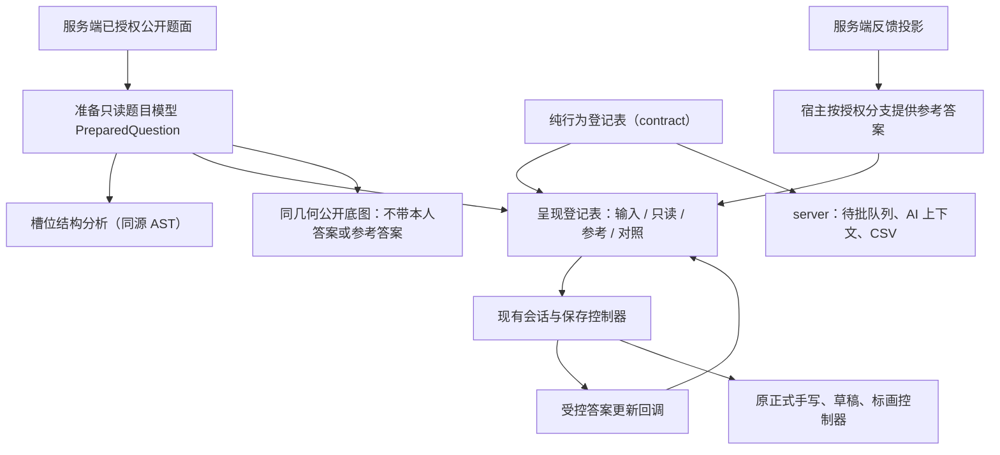

# 统一作答适配层方案

> 2026-10-23 归并：本专题与题型适配共同执行，以 [总任务清单](总任务清单.md) 的 TT 编号、顺序与进度为准。本文件 UA/QM 编号仅作细项定位，不再维护独立项目排期；已定义的安全、兼容与验收约束继续有效。
> 日期：2026-10-23（同日第二轮评审后修订）。
> 状态（2026-10-26 收口订正）：UA-00～UA-05 已全部实施并验收（TT-02～TT-04，I01～I17 逐项证据见验收记录 TT-04 节），业务实现（QM-03 起）已按前置门槛放行并全部验收；本文件为设计意图存档，实施口径以[决策记录](决策记录.md)为准。
> 目标：用可核对的行为等价与边界约束，把「新增一种作答形态」收敛为登记表、自身文件与明确中央扩展点的有限改动。
> 原则：先适配旧七题型，再扩新交互；接口须经新题型推演与测试内演练证明可承载，不能只按现有五种答案拟合。精确性通过测试、类型、权限和几何验证落实，不能仅靠抽象名称保证。

### 修订记录

| 修订点 | 原稿 | 修订后 |
| --- | --- | --- |
| 适配器接口 | 仅列职责，「名字实施时定稿」 | §4.3 给出类型草案，作为 UA-00 评审对象 |
| 纯行为层位置 | 仅 apps/web | 移入 packages/contract，server 批改队列序列化与 AI 上下文文本化一并收口（输出逐字不变） |
| 内联槽位 | 仅抽取 fill 空位统计 | 在既有 DirectiveSessionContext 内建立槽位命名空间，fill 作为首个等价接入方 |
| 对照呈现 | 本人/参考各自独立呈现 | 适配器增加按槽位对齐的对照呈现，合并结果页与教师端两套选项对照 |
| 选项身份 | 仅零起索引，React key 用选项文本 | 选项项为 `{ key, index, text }`，修复重复选项文本的 key 冲突 |
| 扩展验证 | 只验旧行为 | 新增新题型接口推演表、测试内假 kind 演练、登记表外 kind 分支守护 |
| 小勘误 | judge「题面内按钮」、I02 诊断口径、缓存身份 | 按代码事实修正（§4.1、I02、§8） |

## 1. 核心结论与范围

现有 Markdown/DSL 核心继续保留：注册表 → remark 宿主 → 类型化 React 组件，复用 RichMarkdown、GFM、KaTeX、sanitize 与静态解析管线。本阶段在其上建立**作答交互适配层**，由两份按答案 kind 穷尽的登记表组成：

1. **纯行为登记表**（packages/contract，server/web 共用，无 React/DOM 依赖）：已答判定、按命名口径的文本化、结构形状检查。
2. **呈现登记表**（apps/web）：输入、只读、参考、对照四种呈现与完整度。

首版按 StudentAnswer 的五种既有 kind 建立：judge、choice、multi、fill、final。旧 solve/apply/find-error 共用 final，不删除旧题型，不迁移旧答案。choice/multi 复用选项行组件，但保留不同答案类型和原生 radio/checkbox 语义，不合并为万能 selection 类型。

后续 response、cloze、matching、ordering 各接入确实新增的答案结构；阅读、资料分析、证明、作文等领域名称不各建一套适配器。本阶段须用推演与演练证明这些形态**能**放进同一接口（§11），但不实现它们。

**本阶段仅做结构整理和等价接入**。主观题停止自动匹配与默认自评仍在主清单 QM-10/11 实施；适配层从一开始不包含自动匹配、分数或评判来源决策。

本阶段不新建运行时插件平台、通用表单框架、作答状态机、草稿存储、证据调度器、数据库字段或公开 API。需要跨包的新契约元数据先定义 Zod；仅 web 内部的派生模型和 React props 不强行变成持久化内容契约。

## 2. 当前实际边界与风险

| 已核对的代码 | 当前职责 | 方案处理 |
| --- | --- | --- |
| contract/content.ts、grading.ts | 七题型，五种学生答案 kind；`formatQuestionAnswers`、`lettersOf` | 保留数据形态和身份；纯行为登记表落在 contract，复用既有函数 |
| contract/capability.ts | 题型输入/证据/校验能力，inputType 粒度较粗 | 继续作为领域能力声明，不直接当 React 组件索引 |
| QuestionSurface.tsx | 判断/选择/填空输入、公开题面和底图模式 | 保留外部兼容壳与稳定 DOM，内部委托呈现登记表 |
| HandwrittenControls.tsx、FinalAnswerInput.tsx | final 输入、正式手写、引擎控制器 | 保持挂载位置和控制器所有权，消费 final 呈现 |
| answer-format.ts | `isAnswered`、`formatStudentAnswer`、`formatReferenceAnswers`、`HANDWRITTEN_TYPES` | 委托纯行为登记表，保留现有导出和旧口径 |
| question-completion.ts | empty/partial/filled；用真实 AST 数填空 | 迁入槽位结构分析，不能用正则简化，不能代替旧 isAnswered |
| server/services/mark-response.ts `serializeStudentAnswer` | 待批队列/教师端的本人答案文本（judge 正确/错误、multi 去重升序「、」连接、fill「；」连接） | 迁为纯行为登记表的 `teacher-queue` 口径，输出逐字不变 |
| server/services/ai-companion/student-ai-context.ts `studentAnswerTextOf` | AI 受控出口的本人答案文本（choice/multi 附选项正文、final 空时标注在笔迹材料中） | 迁为 `ai-context` 口径，输出逐字不变；按受控出口规则加跑 security-review |
| markdown/directives/session-context.tsx | 指令会话单一 Context，已有 fill、telemetry 子命名空间，注释明确「后续能力在同一 Context 子命名空间内扩展」 | 在此新增槽位命名空间，不另建 Provider |
| AttemptResultParts `ResultOptions`、teacher-attempts `DetailOptions` | 结果页与教师详情各写一套选项对照 | 合并为 choice/multi 的对照呈现，后台布局仍由宿主管理 |
| QuestionFeedback、practice 协议服务 | 逐题卷反馈状态和授权投影 | 按真实契约分支呈现，不靠本地 sourceType 或 answers 非空推断公布 |
| question-base-image.tsx | 挂载公开副本、测量几何、字体与签名 | 仍走同一 QuestionSurface，严格核对几何，不自动替换旧底图 |
| static-markdown.tsx | 共用解析管线，独立静态宿主与显式降级 | 有意保留输出差异，不要求所有出口使用完全相同 DOM |
| AttemptQuestionCard 等处 9 处 `HANDWRITTEN_TYPES` 分支 | 纸面标题、草稿/手写切换 | 改为读取题型绑定上的纸面角色 |

**三种文本口径有意不同**，不是重复缺陷：结果页（judge「对/错」、multi 升序不去重直接拼字母、空值「（空）」）、待批队列（见上）、AI 上下文（附选项正文）。收口的含义是**同一 kind 的各口径集中在同一文件、由同一穷尽登记表约束**，而不是强行合并成一种输出。

当前 inputType=ink 关联正式手写和 final 文本，不能直接等同 answer.kind，也不能因「统一」把正式手写改成普通 textarea。逐题反馈已存在 released/pending_attempt/restricted/not_submitted 等语义；执行者必须读取当前 practice-workflow-service 与 wiring。

## 3. 分层与所有权



| 层 | 负责 | 不应接管 |
| --- | --- | --- |
| 内容/契约层 | 题型、答案 schema、公开投影、快照、能力声明、纯行为登记表 | React、DOM、浏览器缓存、判分 |
| 结构分析层 | 从公开题面提取空位/选项/槽位等确定结构 | 参考答案、保存请求、判分、持久化 AST |
| 呈现层 | 类型对应、输入与展示、对照、既有完整度 | 登录归属、提交锁定裁决、公布、网络请求 |
| 会话/宿主层 | 当前账号/作答/题目/阶段、保存、防抖、收笔、冲突、焦点 | 每处重写题型输入和答案格式 |
| 反馈层 | 已授权参考答案与服务端判定的呈现入口 | 根据本人答案比对得出对错或推断公布权限 |
| 证据层 | 现有纸面、矢量、底图、版本、封存、导出 | 让适配器直接创建或释放手写引擎 |
| 材料/题组宿主（QM-08） | 共享材料、题组编号与阅读位置 | 位于适配层之上；适配层只接收引用，不复制材料 |

## 4. 映射、模型与接口

### 4.1 题型绑定

| QuestionType | Answer kind | 输入位置 placement | 纸面角色 paperRole |
| --- | --- | --- | --- |
| judge | judge | 题干下方判断按钮（题干尾部空标记替换为「（　）」） | scratch |
| choice | choice | 题干下方 radio 选项 | scratch |
| multi | multi | 题干下方 checkbox 选项 | scratch |
| fill | fill | 题干内联槽位 | scratch |
| solve | final | 原 HandwrittenControls 的最终答案位置 | answerInk |
| apply | final | 同 solve | answerInk |
| find-error | final | 同 solve | answerInk |
| response | response | 题干下方多行正文（below-stem） | answerInk（与正文并存） |
| matching | matching | 题干下方配对控件 | scratch |
| ordering | ordering | 题干下方排序控件 | scratch |

后三行为 TT-01 定稿新增（D2 新题型枚举、D14 paperRole，见决策记录 §5.7.2；生产 schema TT-05 落地）。response 证明 paperRole 挂在题型绑定上、不能从 answer kind 推导（同为非 final 的 kind 既有 scratch 也有 answerInk）。

跨端证据角色先在 contract 定义 Zod 元数据及穷尽题型绑定，保持现有能力词表与 capabilities.json 的语义不变。正式纸面资格由此单源派生，placement 仍仅属于 web。建立 web 内部穷尽映射 `questionBindings satisfies Record<QuestionType, QuestionBinding>`。它是 UI 的题型→答案 kind/输入位置/纸面角色绑定，不另存 `interactionKind` 到每道题。**纸面角色挂在题型绑定上，与 answer kind 正交**：后续 response 可能是「正文＋正式手写」并存，不能从 kind 推纸面。

`HANDWRITTEN_TYPES` 与 contract 的 `HANDWRITTEN_QUESTION_TYPES` 均保留兼容入口，由同一跨端证据角色绑定派生；一致性测试覆盖作答会话、讲练页、CSV 与复习包。新增元数据不得改变当前七题型资格。本阶段不重写 contract 能力词表或 capabilities.json 语义。

### 4.2 派生模型 PreparedQuestion

以 kind 判别的只读联合，持有明确挑选的公开内容及对应结构：

- judge：公开题干、尾部空标记展示方式。
- choice/multi：公开题干、选项项 `{ key, index, text }[]`。旧题 `key` 由序号派生（如 `opt-0`），新结构可用稳定 optionId；答案格式不变，仍存 index。
- fill：公开题干、槽位结构（§8），每个槽位 `{ slotId, slotKind: "text", order }`；旧空位 slotId 由序号派生。
- final：公开题干、既有最终答案输入描述。
- 公共：可选 `context` 引用（预留给 QM-08 材料/题组），只存引用不复制内容。

该模型不是新的服务器真相，不保存参考答案、解析、学生草稿、回调、React 元素或控制器。答案变化不重新准备。

入口必须来自现有服务端公开投影，按字段白名单构造，不得 `{...fullQuestion}` 带入。`questionPublicSchema.parse` 不负责把 stemMd 中的参考答案脱敏，不能替代 studentStemMd/publicOfSnapshot。questionRevisionId 等会话身份由宿主携带，UI 准备过程不生成版本号。

### 4.3 接口草案（UA-00 评审对象）

> 2026-10-23：UA-00 演练后本草案已被决策记录 §6.1 七项调整修订，以 §6.1 为准。

```ts
// packages/contract/src/answer-kinds/types.ts —— 纯层
export type AnswerKind = StudentAnswer["kind"];
export type AnswerOf<K extends AnswerKind> = Extract<StudentAnswer, { kind: K }>;
export type ReferenceOf<K extends AnswerKind> = /* 由 QuestionAnswers 推导，不手抄 */;

/** 文本口径：各自保持现有输出，逐字等价 */
export type AnswerTextProfile = "display" | "teacher-queue" | "ai-context";

/** 每种答案携带自己的公开结构类型；不得包含参考答案或解析。 */
export interface AnswerKindBehavior<A extends { kind: string }, S> {
  isAnswered(answer: A): boolean;
  formatStudent(answer: A, profile: AnswerTextProfile, structure: S): string;
  inspectShape(answer: A, structure: S): readonly ShapeIssue[];
}

export type AnswerKindBehaviorTable<
  U extends { kind: string },
  Structures extends { readonly [K in U["kind"]]: unknown },
> = {
  readonly [K in U["kind"]]: AnswerKindBehavior<Extract<U, { kind: K }>, Structures[K]>;
};
```

生产结构映射 `PublicStructureByKind` 从公开契约及其派生类型构成，登记表使用 `satisfies AnswerKindBehaviorTable<StudentAnswer, PublicStructureByKind>`。此处是接口约束草案，`ShapeIssue`、结构映射与下文呈现类型必须在 UA-00 原型中补齐并实际编译，不以文档代码块代替验收。

- choice/multi 结构提供选项身份与正文；fill 提供有序槽位与旧数组下标映射；judge/final 仅提供其所需公开信息。
- 扩展演练中的 ordering 提供 itemId→正文、合法项集合与固定位置；matching 提供槽位、合法目标及是否允许重复；cloze 提供每个槽位的候选项身份与正文。
- 形状检查不接触正确顺序、正确配对或标准答案；不自动修复或阻止现有保存。
- `null/undefined` 的无答案口径由兼容入口处理：展示为「未作答」、队列及 AI 入口保持原有 null，不伪造某个 kind 的空答案。

参考答案文本化继续以 contract `formatQuestionAnswers` 为核心（web 注入 mathify），保留为唯一参考文本入口及允许修改的中央穷尽分支，不再声称已迁入纯行为登记表。新增参考 kind 必须修改该函数及差分测试；不得让它与登记表互相导入形成循环。

```ts
// apps/web/src/features/answering/types.ts —— 呈现层
export interface AnswerKindView<K extends AnswerKind> {
  Input(p: { model: PreparedOf<K>; answer: AnswerOf<K> | undefined; update: AnswerUpdate<K> }): ReactNode;
  ReadOnly(p: { model: PreparedOf<K>; answer: AnswerOf<K> | undefined }): ReactNode;
  Reference(p: { model: PreparedOf<K>; reference: ReferenceOf<K> }): ReactNode;
  Comparison(p: {
    model: PreparedOf<K>;
    answer: AnswerOf<K> | undefined;
    reference: ReferenceOf<K>;
    /** 服务端已给出的逐槽/题级判定；呈现层只显示，不计算 */
    verdicts?: ServerVerdicts;
  }): ReactNode;
  completion(model: PreparedOf<K>, answer: AnswerOf<K> | undefined, formalInk: boolean): QuestionCompletion;
}
export const answerKindViews = { judge, choice, multi, fill, final }
  satisfies { readonly [K in AnswerKind]: AnswerKindView<K> };
```

- `AnswerUpdate<K>` 保留现有 `defer` 语义：fill `defer=true`，选择/判断即时，final 走原路径（I05）。
- inline 槽位类 kind 的 `Input` 通过槽位命名空间（§8）注入题干内控件，而不是在题干外渲染。
- 呈现登记表与纯行为登记表分文件，共用 `AnswerKind`；后台/CSV 只导入纯层，不静态引入 React、MathLive、纸面或结果重模块（I14）。

### 4.4 调度与类型安全

动态从联合里取函数会产生参数交集问题。允许在**唯一调度边界**（`dispatchView`/`dispatchBehavior`）按 kind 显式 switch 后调用窄化实现，并以 `assertNever` 收尾；不追求「零 switch」。新增 kind 允许在这两个中央调度边界增加穷尽分支，这是明确的扩展触点。禁止 `any`、双重断言或强转 React 组件绕过相关性错误。题型与答案 kind 的相关性在准备模型时验证。

调度边界以外，业务代码**不得新增**按 `answer.kind` / 题型字面量的分支（§11.2 守护）。

## 5. 三种呈现模式：协议清楚、几何稳定

首版对外兼容 QuestionSurface 的 `mode` 与 `readOnly`；内部转换成互斥模式。原位题面使用同一个稳定组件类型接收模式联合，不能通过切换 Input/ReadOnly 组件类型实现锁定；登记表的 ReadOnly 是独立结果材料呈现入口。UA-00 须补齐包含 public-base 的类型负例和模式转换原型。

| 模式 | 本人答案 | 参考答案 | 更新能力 | 几何要求 |
| --- | --- | --- | --- | --- |
| edit | 有，可为空 | 无 | 有；由宿主保存 | 保持旧题面/输入结构 |
| readonly | 有，可为空 | 无；参考与对照另走授权反馈入口 | 无 | 提交后原位锁定，不换宿主造成题面跳动 |
| public-base | 无，即使误传也须从数据流剔除 | 无 | 无 | 与原公开题面同布局，空位保留原尺寸 |

对照（Comparison）与参考（Reference）只在反馈入口按 §6 授权分支调用，不是第四种题面模式，也不进入 public-base。仅 public-base 为圈画公开底图；带本人答案的 PNG/复习导出由独立只读材料组合器添加本人答案和原稿。

类型上 edit 分支必须有更新函数，readonly/public-base 不能有。运行时仍拦截 readonly/public-base 事件；inert/disabled 不能充当唯一权限控制。

旧壳参数转换优先级：`mode=export` 总是 public-base；否则 `readOnly=true` 为 readonly；其余为 edit。既有预览允许未传 onAnswer，兼容壳用稳定无副作用回调维持旧表现，不擅自改为 disabled。

公开底图沿用旧 DOM、class、data-slot、间距、字体和输入占位尺寸；禁止新增无必要 wrapper（新增 wrapper 按几何变更处理）。live 与导出同时存在时 radio name 实例隔离；布局和普通属性变化时同一 live 输入保持节点身份。正式手写的收笔、落盘、封存与提交锁定后释放仍由旧宿主执行。

## 6. 安全与已公布参考答案的边界

宿主先对当前真实 PracticeQuestionFeedback/结果契约做穷尽分支：

- released：显式提供允许公开的本题参考答案与解析；缺参考答案显示原有空态。
- pending_attempt/restricted/not_submitted：不创建参考/对照展示数据。
- 旧结果 `answersReleased` 与 lesson 已提交释放：由各自现有边界转换成相同的展示输入，不在适配器里重写 sourceType 判断。

内部用 `unavailable / available` 判别联合表达参考材料，不以「answers 对象存在」替代公布权限。available 只说明服务器允许显示，不等于有参考答案，也不等于 AI 可用。

颜色、正确项标记和判定徽章消费已授权的现有结果。对照呈现不比较学生选项、长文或公式来计算 verdict；选择题参考项装饰与服务器题级判定保持不同职责。

纯行为层的 `ai-context` 口径只做文本化，**不决定**是否外发；外发与否仍由 teaching-policy-service 与三个受控出口按当前模式与完成态裁决。迁移 student-ai-context 时 AI 双断言测试不改、不放宽 assertNoLeak。

模型缓存不得存参考答案/原稿，不使用按 questionId 的模块级全局答案缓存；适配层不新建 localStorage/IndexedDB 副本。

## 7. 精确性不变量

本阶段合并门槛；行为改变另立有明确目的的修复。

| 编号 | 必须保持的事实 | 验证方法 |
| --- | --- | --- |
| I01 | 七题型全部绑定，五答案 kind 在两份登记表全部实现 | 编译期穷尽＋集合覆盖测试 |
| I02 | 题型/答案 kind 不匹配时沿用现有 UI 表现，不改写成空答案、不自动保存；诊断只经测试钩子与开发模式日志暴露，本阶段不新增用户可见提示 | 原值保留、无保存请求断言 |
| I03 | 判断 false、单选 index=0 都是有效输入 | 事件/填写特征测试 |
| I04 | 单选索引、多选数组、填空顺序、final 原字符串不被自动排序/归一化/裁剪 | 逐字段输出和事件序列断言 |
| I05 | fill 仍 defer=true，选择/判断即时回调，final 保留旧路径 | 回调次数与 defer 值断言 |
| I06 | isAnswered 与 completion 保持各自口径 | 分开特征测试 |
| I07 | 槽位统计与真实渲染同源，代码/数学不误计，显式 blank 与跨段编号保留 | 语料变体测试及浏览器输入对应 |
| I08 | readonly/public-base 永不触发答案变更 | 类型负例＋运行时强制事件测试 |
| I09 | 未公布时参考/对照内容不进入模型、DOM、导出树 | 哨兵与泄露测试（沿用 AGENTS 规则 3） |
| I10 | 切布局/普通属性不重建 live 宿主与引擎；提交锁定按原流程安全释放 | 节点、控制器、焦点、撤销历史测试 |
| I11 | 现有样例公开底图内容、字体、blocks 几何和签名不漂移 | 真实 Chromium/WebKit 测量与签名断言 |
| I12 | 冻结引用、CAS、提交、公布、评分、自评、证据封存与 AI 教学策略不被改写 | 网络/服务回归；无持久化/API schema 或 DB 迁移；仅新增内部契约元数据 |
| I13 | 同一公开题目对象不因每次输入重新解析；新回调/样式/上下文仍更新 | 调用计数与 rerender 测试 |
| I14 | 纯层与组件图不提前引入 MathLive、结果重模块、纸面引擎；server 不依赖 web | 构建 chunk/导入依赖检查 |
| I15 | display、teacher-queue、ai-context 三种文本口径对既有语料逐字等价 | 旧实现与新登记表差分测试（含空、越界、重复、历史 judge 字符串） |
| I16 | 调度边界以外不存在按答案 kind/题型字面量的新分支 | 守护测试（扫描源码白名单） |
| I17 | 测试内扩展可经登记表、自身文件与允许的中央调度边界接入，不修改业务宿主 | UA-00 首次通过 §11.3 演练，UA-05 重跑 |

### 7.1 必须保留的特殊口径

- 旧 isAnswered(fill) 是至少一个非空答案；完整度是有效空位是否填齐；额外数组项不能填补空位。
- 旧 final 有正式笔迹但未填最终答案的完整度为 partial；本次不改成 filled。
- judge 允许历史字符串；输入控件只认布尔，字符串展示走旧兼容逻辑。不调用 judgeOf 改写历史值。
- 多选空数组、重复索引、越界历史数据分别覆盖；display 口径不去重、teacher-queue/ai-context 去重，均按现状锁定。
- 仅格式化可沿用 trim/mathify 展示行为，不能将显示结果反向写回答案。

## 8. 槽位结构、错误与缓存

### 8.1 槽位结构分析

fill 目前通过 processor、remarkBlank、remarkDirectiveHost 得到空位，再用 WeakMap 缓存（question-completion.ts）。本阶段抽成单一槽位分析入口 `analyzeSlots(stemMd)`，复用现有节点语义，输出有序槽位 `{ slotId, slotKind, order }`。禁止换成正则统计或另建空位识别规则。

首版只共享结构分析结果，不强制 RichMarkdown 改用一套新 AST，不承诺「全链路只 parse 一次」。缓存首版**沿用对象身份 WeakMap**（I13 按对象身份计数）；是否改为公开内容哈希留待有性能证据时单独决定。缓存只存无答案派生结构，不混入账号/attempt 级数据。

### 8.2 槽位命名空间（内联输入的扩展点）

在既有 `DirectiveSessionContext` 新增 `slots` 子命名空间，不新建顶层 Provider：

```ts
interface DirectiveSlotsState {
  /** 当前题目或材料的公开作用域标识；不生成持久化版本 */
  readonly scopeId: string;
  /** 按 slotId 取当前槽位值与控件描述；返回 null 渲染展示空框 */
  readonly get: (slotId: string, slotKind: SlotKind) => SlotBinding | null;
  readonly disabled: boolean;
}
```

- fill 是本阶段唯一接入方：现有 `fill` 命名空间与 `BlankAnswersProvider`、`useDirectiveFill` 保留为兼容入口，内部委托 `slots`；BlankDirective 的 DOM、class、尺寸不变（I11）。
- 本阶段 `SlotKind` 只有 `"text"`；cloze 的 `"choice"`、matching 的 `"match"` 由 QM-13 经契约定义后加入，届时只新增槽位控件与登记表项，不改 remark 宿主。
- 新槽位指令仍走 AGENTS 规则 11 的「注册表 → 组件 → 样例测试 → gen:spec」。

槽位身份为 `(scopeId, slotId)`，slotId 仅在作用域内唯一。独立题干沿用既有顺序到 values 下标的映射；共享材料由 QM-08 宿主提供明确的槽位→所属子题绑定，不能依赖当前选中题或多个 Markdown 根各自的局部序号推断。跨根顺序由公开结构确定，不能由挂载顺序生成。

Provider 未传字段继承外层；显式 null 必须同时遮蔽旧 fill 与新 slots 的兼容读取，二者同时提供且冲突时开发诊断并采用明确的单一优先级（新 slots 优先）。公开底图显式覆盖为空值、无副作用更新的中性槽位绑定，禁止继承真实答案；不能简单传 null 退回尺寸不同的展示 span。只读模式保留输入节点并阻断更新。

必测：两题同名槽位、材料与题干跨根编号、不同题提交锁定、外层真实答案与内层公开副本、显式 null 遮蔽、旧 fill Provider 兼容，以及中性输入的几何等价。共享材料交互本阶段只做测试原型，生产接入留给 QM-08/13。

题干、选项、真实版本变化需要重准备；本人答案变化不重准备；回调不放进缓存。React memo 保留默认属性比较。

### 8.3 错误处理

1. 当前合法内容：行为必须与旧实现一致。
2. 旧坏数据或新未知结构：保留原文与原答案，按 I02 诊断，禁止自动清空或换题。新校验不能让可读旧卷变不可读；收紧保存规则另做服务端契约与迁移评估。

题型/答案不一致时，不「尝试另一适配器」，不按答案 kind 改题型。未知可交互类型不得降级为可提交的空题；普通未知 Markdown 展示指令仍按既有规则降级。`inspectShape` 只报告问题，本阶段不接入保存拦截。

## 9. 几何与证据保护

question-base-image 从挂载题面获取宽高、blocks、字体，挂载同宽公开副本，比较 before/copy/after 并保存签名。这条验证不能被适配器短路。

本阶段不更改 ANNOTATION_SURFACE_RENDER_VERSION 或 schema 来接受几何漂移。若实现必须改变几何，停止该迁移步骤，另做有授权的版本兼容设计，不删除比对、不放大容差、不自动覆盖旧底图。

正式手写的 host、控制器、doc、历史和账号隔离由原路径持有；适配器不统一 createRoot 或重建 canvas。

## 10. 文件设计与渐进接入

具体命名在 UA-00 核实，避免与既有实现重复。

| 文件/模块 | 职责 |
| --- | --- |
| `packages/contract/src/answer-kinds/types.ts` | AnswerKind、AnswerOf、ReferenceOf、口径与泛型登记表类型 |
| `packages/contract/src/answer-kinds/{judge,choice,multi,fill,final}.ts` | 各 kind 纯行为：已答、三口径文本化、形状检查 |
| `packages/contract/src/answer-kinds/index.ts` | `answerKindBehaviors` 登记表与 `dispatchBehavior` |
| `apps/web/src/features/answering/question-binding.ts` | 七题型穷尽绑定、纸面角色、能力一致性检查 |
| `apps/web/src/features/answering/prepare-question.ts` | 公开内容→PreparedQuestion，含 `analyzeSlots` |
| `apps/web/src/features/answering/views/*.tsx` | 各 kind 的 Input/ReadOnly/Reference/Comparison/completion，从原代码抽取 |
| `apps/web/src/features/answering/index.tsx` | `answerKindViews` 登记表与 `dispatchView` |
| 各 `*.test.ts(x)` | 类型负例、口径差分、模式、隔离、守护与演练 |

过小文件可合并。保留旧 answer-format、question-completion、QuestionSurface、`serializeStudentAnswer`、`studentAnswerTextOf` 作为兼容代理；迁移完成后清理代理内部重复代码，过渡期不给新旧两套同时加功能。

HandwrittenControls 的最终答案输入接入 final 呈现，但 HandwrittenControls 本身不被登记表接管；不能在 QuestionSurface 再显示一份 final 输入。server 只从 contract 导入纯层，不从 apps/web 导入任何东西。

### 10.1 消费者迁移验收表

| 现有入口 | 目标与必须保留的行为 | 验证责任 |
| --- | --- | --- |
| answer-format、mark-response、student-ai-context | 三口径委托纯行为；空值、历史值与原文逐字保持 | UA-01 差分及 AI 双断言 |
| QuestionSurface、FinalAnswerInput、HandwrittenControls | 稳定原位题面；final 输入仅一份；控制器所有权不变 | UA-02/03 节点身份、回调、收笔 |
| ResultOptions、DetailOptions | 已公布参考项装饰与本人选项，未公布中性 | UA-03 授权与选项对照 |
| ResultAnswerComparison、QuestionFeedback、LessonQuestionCard、结果页 | 填空逐空对齐、额外历史项、缺参考空态与锁定提示；宿主不再特判 fill | UA-03 对照差分与泄露测试 |
| AttemptSession、StudentLessonPage、CSV、review-pack | 共用跨端证据角色；旧七型笔迹资格与链接不变 | UA-01/03 角色一致性、导出材料测试 |
| analytics、wrong-questions、export-service、CSV | 沿兼容序列化入口消费，统计分组键与输出不变 | UA-01 服务回归 |
| question-base-image、静态宿主、导出组合器 | 中性底图几何、字体、签名与材料完整性 | UA-04 浏览器与证据回归 |

UA-00 把此表落实到具体函数和测试文件，补齐发现的其他消费者；不能用宽泛目录白名单替代迁移。新增参考 kind 必须补 formatQuestionAnswers；新题型共享材料装配仍由 QM-16/17 实现，适配层演练不能替代其验收。

## 11. 扩展契约

### 11.1 新增一种答案 kind 的触点清单（目标）

| 步骤 | 位置 |
| --- | --- |
| ① | contract：学生/参考/公开结构 Zod schema、跨端证据角色绑定、纯行为项、formatQuestionAnswers 参考分支；schema:export |
| ② | md-dsl：抽取、lint；若需内联槽位，新增 SlotKind 与槽位指令（规则 11 四步） |
| ③ | grading：validator 绑定，或在能力表声明为非自动校验 |
| ④ | web：题型绑定、PreparedQuestion/公开结构映射、views 与登记项；两个中央调度边界的穷尽分支及类型测试 |
| ⑤ | samples 与 `pnpm gen:spec` |

结果页、教师详情、待批队列、错题本、AI 上下文、CSV、完整度、导航、交卷未答数**不应再需要改动**；若某处必须改，说明登记表接口缺能力，应补接口而不是在该处加分支。

服务端保存校验、草稿合并若需 kind 特化，经纯层 `inspectShape` 扩展，本阶段不接入。

### 11.2 守护

I16 守护检查 apps/web/src、apps/server/src 的生产源码，排除测试、夹具、生成产物。优先用仓库已有 TypeScript 工具做语法树检查，识别答案/题型判别分支，不能用裸 `case "fill"` 文本匹配误伤其他领域。UA-00 固化既有分支基线与逐项理由，只禁止新增未授权分支；中央调度、绑定与参考格式化属于明确扩展点。动态比较、别名和映射索引仍须人工审查，守护不能替代消费者验收。

### 11.3 测试内扩展演练（UA-00 闸门）

测试局部联合包含 `FakeOrderingAnswer = { kind: "fake-ordering"; itemKeys: string[] }`，并提供其公开结构和参考类型。行为表使用扩展联合与结构映射实例化；呈现原型同步参数化答案、模型、参考三者的关联，不继续绑定生产 AnswerKind。生产仍保持封闭、穷尽联合，不引入运行时插件注册。

允许测试调度边界增加新分支，但业务宿主保持原样；仅证明改动局限在 §11.1 的明确触点，不宣称验证了新题型全部业务链路。演练必须通过真实 tsc 与渲染测试，不能用 any、双重断言或测试专用万能渲染器绕过生产约束。

必须验证：排序 ID 映射正文、固定项/非法项/重复项诊断；配对目标与重复约束；双作用域内联槽位的绑定和独立锁定；完整度、三种文本口径、本人/参考对照、只读无更新与公开副本无答案。无参考、错配参考和历史多余填空项的展示策略须保持当前行为。测试假类型不进入生产 schema。

UA-00 首次完成演练并记录允许修改的文件清单，UA-01 开始前通过；UA-05 重跑，不再首次发现接口缺口。

### 11.4 新题型接口推演（UA-00 填实，接口代入失败即调整接口）

| 形态 | 答案结构（QM-01 定稿） | 槽位 | 完整度 | 对照 | 纸面角色 |
| --- | --- | --- | --- | --- | --- |
| response 开放作答 | 学生 `{kind:"response", title?, body}`；参考 `{kind:"response", referenceMd, variantsMd?}`（整体可缺省） | 无，placement=below-stem | filled = body 非空白**或**有正式笔迹；partial = 有笔迹无正文（I06 final 同款口径不改动）；isAnswered = body 非空白 | 本人正文 vs 主参考 + 备选表达（variantsMd 逐条） | answerInk，与正文并存 |
| cloze 完形 | **不新增 kind**（组合结构，D1）：choice 子题 `{kind:"choice", index}`（不变）+ 材料 `{{slot}}` choice 槽位绑定 | 材料/题干内 SlotKind="choice"（`{{slot}}` 标记） | 按子题（choice 口径） | 每空=每子题 choice 逐题对照（槽位绑定提供「第 N 空」定位） | scratch（choice 子题） |
| matching 配对 | 学生 `{kind:"matching", pairs: Record<slotId,optionId>}`（部分配对=草稿合法）；参考同形（提供时全覆盖槽位） | 材料/题干内 SlotKind="match"（同款 `{{slot}}` 标记）或题干独立槽区 | 已配槽位/总槽位 | 逐槽对齐（本人配对 vs 参考配对；干扰项单列） | scratch |
| ordering 排序 | 学生 `{kind:"ordering", sequence: itemId[]}`（部分序列=草稿合法；固定项在位为结构约束）；参考同形（完整序列含固定项） | 无正文槽位（items 驱动独立排序区） | 已放项/应放项（非干扰项数） | 序列对齐（本人序 vs 参考序；固定项与干扰项标出） | scratch |

上表为 QM-01 定稿内容（决策记录 §5.7.3，2026-10-23 编排者裁定接受；response 完整度口径一并定稿，原「QM-09 定」落定）。TT-02（UA-00）扩展演练已按本表代入 fake-ordering / fake-matching 验证接口可承载，接口调整与演练发现见决策记录 §6.1。

共享材料中的槽位由 QM-08 材料宿主提供 `context`，槽位命名空间以 slotId 定位，不依赖槽位在哪个 Markdown 源里。

## 12. 实施任务与主清单依赖

UA 是本前置阶段专用编号（2026-10-26 收口订正：UA-00～UA-05 已全部验收，执行史见[总任务清单](总任务清单.md) TT-02～TT-04 各次进度备注）。原执行顺序：先完成 QM-00，并确定 QM-01 的答案/公开结构、稳定 ID 与证据角色设计决策，再执行 UA-00～UA-05；主清单 QM-03 起的业务实现以 UA-05 验收为前置（该前置已满足）。QM-01/02 的内容设计和语料编制可先行。

| 编号 | 任务 | 依赖 | 交付/检查 |
| --- | --- | --- | --- |
| UA-00 | 特征基线、可编译接口与扩展演练 | QM-00、QM-01 结构设计决策 | 真实消费者、绑定表、非法数据行为、mode/回调/DOM 约定；§4.3 完整类型原型编译、§11.3 演练通过、§11.4 推演表经确认；失败不得启动 UA-01 |
| UA-01 | contract 纯行为登记表 | UA-00 | 三口径差分（I15）、类型负例、穷尽登记、跨端证据角色及兼容集合一致；web answer-format 与 server 两处改为代理，输出逐字不变 |
| UA-02 | 槽位结构、选项项与轻量输入抽取 | UA-01 | `analyzeSlots` 同源（I07）、`slots` 命名空间与 fill 兼容、选项 `key` 修复（单独提交并附重复选项文本用例）、原回调节奏与 DOM |
| UA-03 | 呈现登记表接入作答、只读、反馈与后台 | UA-02 | 逐个宿主迁移，final 不重复，Comparison 合并 ResultOptions/DetailOptions 与 ResultAnswerComparison，纸面角色替换 HANDWRITTEN_TYPES 分支，真实公布分支 |
| UA-04 | 底图、导出、手写与懒加载核对 | UA-03 | 几何/签名、同宿主与原稿保持、bundle 与 server 依赖检查 |
| UA-05 | 守护、演练、全量验证与前置验收 | UA-04 | I01～I17 逐项证据，重跑 UA-00 扩展演练，登记表外分支守护，设备项，清理重复实现 |

每个任务遵守计划→TDD→质量闸门→验证→合并。UA-01 触及 AI 受控出口文本、UA-03 触及学生反馈载荷，均加跑 security-review。

## 13. 验证方案

### 13.1 类型与纯行为

- 编译期：漏一种 QuestionType/答案 kind 必失败；choice 呈现不接受 fill；只读模式不接受更新函数；public-base 不接受参考内容。负例用写明原因的 `@ts-expect-error`。
- 运行期：七型五 kind × 空答、false/0、空字符串、空数组、部分空、全填、额外空、非法索引、重复索引、不匹配 kind、历史 judge 字符串。
- 口径差分：旧 `formatStudentAnswer`、`serializeStudentAnswer`、`studentAnswerTextOf` 与新登记表对同一语料逐字比较；旧实现只在测试夹具暂留。

### 13.2 DOM、模式与身份

- 精确断言 radio/checkbox/textbox 语义、name 隔离、选中、空位顺序和可访问名称；重复选项文本不再产生 key 冲突告警。
- change/click 后的 payload、调用次数、defer；readonly/public-base 无调用。
- rerender 更新回调后用最新函数，选中/输入/焦点保持；布局、AI、纸面开合不重挂。
- 不以单份巨大快照作为唯一依据。

### 13.3 浏览器与服务边界

- Chromium/WebKit：字体/公式/图片就绪后的几何与签名；jsdom 不能证明像素与手写坐标。
- 复用 `e2e/question-base.spec.ts`、`question-inline-annotation.spec.ts`、`annotation-native-surface.spec.ts`、`annotation-paper-interaction.spec.ts`、`practice-feedback.spec.ts`、`practice-single-workspace.spec.ts` 及确实涉及的 ink 用例。
- 服务接口：投影无泄露；待批队列与 AI 上下文响应逐字不变；AI 三出口双断言不变；无新增保存请求。
- 真实 Pencil 试写/撤销/擦除/切换由设备验收，未完成不写「核心已全部验证」。

使用 pnpm test/typecheck/lint/build/schema:export/gen:spec（确有生成影响时）和隔离 E2E，每步记录命令、退出码、相关输出。

### 13.4 方案分析时的现状基线

原稿编写时实际运行（修订未改代码，未重跑）：

```text
pnpm exec vitest run apps/web/src/features/attempt/QuestionSurface.test.tsx apps/web/src/features/attempt/question-completion.test.ts apps/web/src/features/attempt/answer-format.test.ts apps/web/src/features/attempt/ResultAnswerComparison.test.tsx apps/web/src/features/attempt/AttemptQuestionCard.test.tsx apps/web/src/features/attempt/AttemptQuestionCard.layout-identity.test.tsx apps/web/src/features/attempt/sample-rendering.test.tsx apps/web/src/features/markdown/directive-registry-consistency.test.ts apps/web/src/features/annotation/question-base-image.test.tsx packages/contract/src/capability.test.ts

Test Files  10 passed (10)
     Tests  123 passed (123)
  Duration  13.19s
```

退出码 0；存在既有 Vite 配置加载方式预警。未跑全仓构建/类型检查/E2E、浏览器几何和 Pencil 验收。UA-00 须补跑 mark-response 与 student-ai-context 相关服务端测试作为新增迁移面的基线。

## 14. 完成与停止条件

**本阶段完成**：旧七型所有原行为都有去向，I01～I17 逐项证据可查；作答/反馈/教师/底图/待批队列/AI 上下文等真实消费者接入；§11.1 适配层触点经扩展演练验证（新题型业务全链路另按 QM 验收）；不增加新的状态与秘密流转；没有几何漂移、引擎重挂和历史数据改写；必需设备项完成，才能作为新题型开发前置验收。

**必须停止并单独处理**：为了通过测试需删除旧断言、改变答案序列化或任一文本口径、放宽公布条件或 AI 教学策略、绕过 CAS、接受几何漂移、自动替换历史底图，或引入无明确需求的通用框架。先说明具体冲突和影响，不能以「统一适配」名义改动核心语义。
